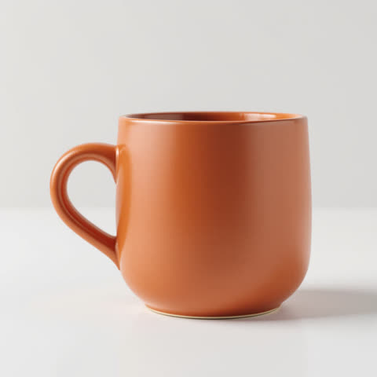

# Real run

One ad concept rendered by this skill's Wireflow app (`skill-ad-creative-variations`, three Nano Banana 2 nodes at 1K) on 8 October 2026. Files here are downscaled; originals are on the Wireflow CDN.

## Product image

A packshot made in the bulk-image-generation skill test: https://cdn.wireflow.ai/a7492500-c2d4-11f1-9e92-2dd4e060cd9a.jpg

## Concept: ritual

- `ad_brief`: Headline, exactly: "Slow mornings, made better". Call to action button, exactly: "Shop the mug". Visual: the terracotta mug on a sunlit wooden kitchen table beside an open paperback, steam rising, warm morning light, soft cream and terracotta palette, headline in a bold modern serif at the top, rounded button near the bottom.
- Execution: `4ec58474-6e58-4a89-b47c-8224ba466a39`
- Credits: 60 for the three images (account balance before minus after)

| Ratio | Image | Original |
|---|---|---|
| 1:1 (1024x1024) |  | https://cdn.wireflow.ai/423c0b90-c2d5-11f1-9e92-2dd4e060cd9a.png |
| 4:5 (928x1152) |  | https://cdn.wireflow.ai/43774ab0-c2d5-11f1-9e92-2dd4e060cd9a.png |
| 9:16 (768x1376) |  | https://cdn.wireflow.ai/42477d40-c2d5-11f1-9e92-2dd4e060cd9a.png |

Honest notes: headline and button text are spelled correctly in all three. The 1:1 version framed the photo inside a cream margin rather than running it to the edge, and the button style changes between ratios (a filled terracotta pill in 1:1, a light pill in 4:5 and 9:16).

The run used the Wireflow Apps API (`POST /api/v1/apps/skill-ad-creative-variations/execute`), the same code path as the MCP `run_app` tool.
