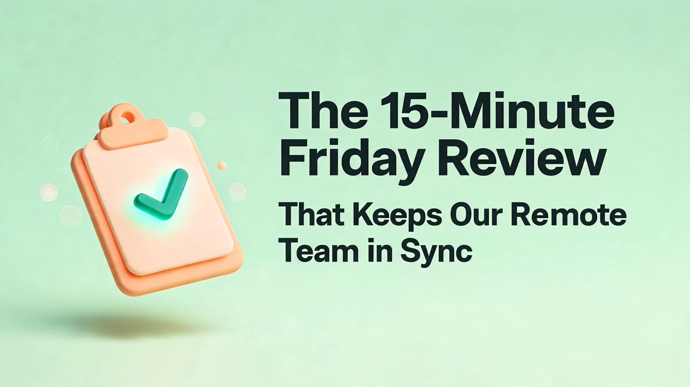

# Real run

One run of this skill's Wireflow app (`skill-ai-blog-featured-images`: Run any LLM with Claude Haiku 4.5, then two Seedream 5 Lite nodes at landscape 16:9) on 28 October 2026. The files here are downscaled to 1280 px wide; the originals are on the Wireflow CDN.

## Inputs

- `post_title`: The 15-Minute Friday Review That Keeps Our Remote Team in Sync
- `post_summary`: A 12-person remote agency replaced two weekly status meetings with one written 15-minute Friday review: three questions, one shared doc, async comments. The post shares the template, the rules that keep it short, and what changed after a quarter: fewer meetings, fewer missed handoffs.
- `style_note`: Soft 3D clay illustration, rounded shapes, pastel sage green and warm peach palette with a deep teal accent, gentle studio light, calm and friendly, plenty of empty space.

Execution: `6d893fe5-cb36-4376-8d49-73df2e688a9f`. Credits: 23 for both images (account balance 6,291 before, 6,268 after; 10 per image plus 3 for the concept step). Time: under a minute.

## Results

| Output | Image | Original |
|---|---|---|
| Hero (3072x1728, no text) |  | https://cdn.wireflow.ai/001a3050-d27c-11f1-a3c4-69a2c8f50396.jpg |
| Share card (3416x1920) |  | https://cdn.wireflow.ai/16a29f10-d27c-11f1-a3c4-69a2c8f50396.jpg |

Honest notes: the concept step chose a single clipboard with a check mark, a fair fit for a "weekly review" post, and the hero has no stray letters or logos. The share card is clearly the same picture, with the clipboard moved left. The title is spelled correctly and is the only text; it sits inside the 1.91:1 safe band, so a 1200x630 crop keeps all of it. It wraps to four lines, although the app's rules ask for three at most, and the second half is set smaller than the first. That reads fine here, but longer titles will get crowded, which is why the skill offers a shorter display title past about 70 characters.

The run used the Wireflow Apps API (`POST /api/v1/apps/skill-ai-blog-featured-images/execute`), the same code path as the MCP `run_app` tool.
