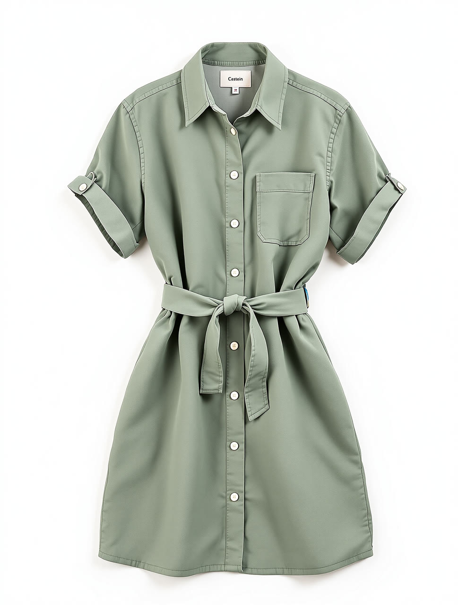
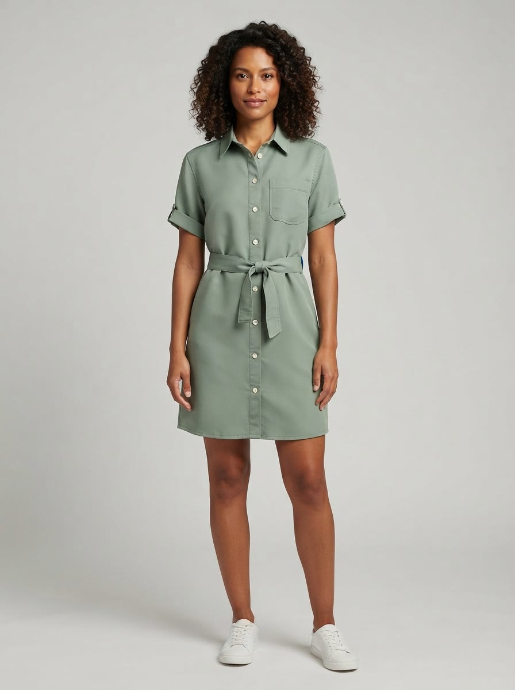
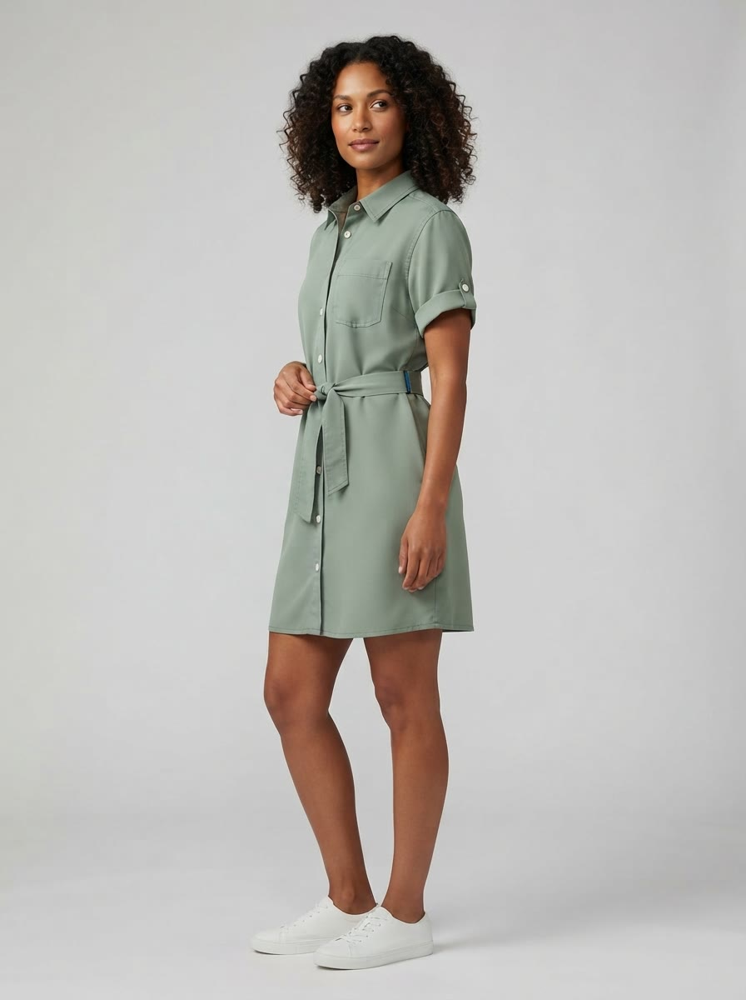
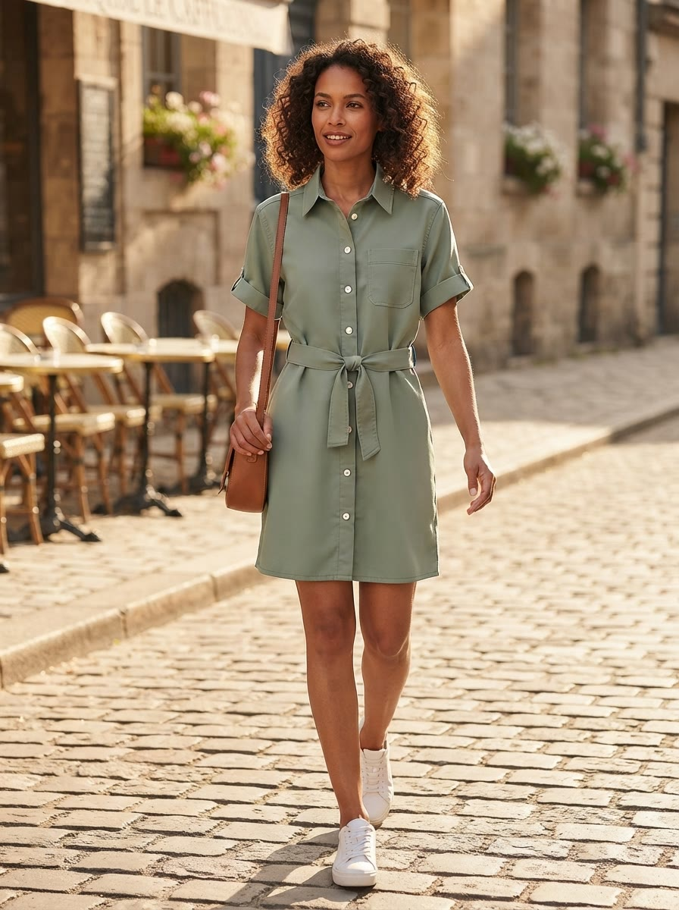

# AI Fashion Model Photos for Ecommerce for Claude Code

| Your garment | Front | Three-quarter | Lifestyle |
|---|---|---|---|
|  |  |  |  |

*One flat lay in, three on-model shots out, one call. Made with this skill on 15 Oct 2026: Nano Banana Lite, 48 credits for all three. Inputs, receipt and honest notes in [examples](examples/EXAMPLES.md).*

Skip the model shoot. Give Claude a flat-lay or ghost-mannequin photo of a garment and say who your buyer is. The skill writes a model brief and a lifestyle setting you can edit, quotes the credits and waits for your yes. A Wireflow app then dresses a generated model in your exact garment and returns a store-ready set: a full-length front shot and a 3/4 shot on a clean grey studio backdrop, plus one lifestyle shot. Claude compares every photo with your original (color, collar, buttons, pockets, length) and tells you what drifted before you upload anything.

No Wireflow connection? You still get a garment photo checklist, a model brief and three shot prompts filled in for your piece.

## Try it

```text
Here's my flat lay: https://example.com/linen-dress.jpg
Put it on a model in her 30s for my Shopify store: two studio shots
and one walking down a sunny street.
```

Also triggered by: "on-model photos", "virtual model for my clothes", "model shot from a flat lay", "apparel catalog photos", "the same dress on different models".

## How to install

```text
/plugin marketplace add wireflowINC/skills
/plugin install wireflow-skills@wireflow
```

The plugin brings the Wireflow skills and the connector; run `/mcp` → `wireflow` → sign in.

Only this skill: `npx skills add wireflowINC/skills --skill ai-fashion-model-photos-for-ecommerce`, or copy `skills/ai-fashion-model-photos-for-ecommerce` into `~/.claude/skills/`, then add the connector with `claude mcp add --transport http wireflow https://www.wireflow.ai/api/mcp` (Claude.ai and Desktop: custom connector, same URL).

## Works with

- **Claude Code**: where this skill is built to run. Install the plugin or use the skills CLI.
- **Claude.ai and Claude Desktop**: add Wireflow as a custom connector. Saving files needs a shell, so there you get the image links instead.
- **Cursor, Codex and other agents that read `SKILL.md`**: the skills CLI installs it there. Rendering needs that agent connected to the Wireflow MCP server; we have not tested those agents ourselves.

## Credits

| What | Credits |
|---|---|
| Photo check, model brief, setting, quote | 0 |
| One run: front, 3/4 and lifestyle of one garment on one model | 48 (16 per image, Nano Banana Lite, measured 15 Oct 2026) |
| The same garment on a second model | 48 more, after a yes |

Wireflow's Free plan lets you build and browse and includes a first image after setup; generating on-model sets needs a paid plan, from US$24 a month.

## What it will not do

- Change your garment on purpose: cut, color, print and trims stay as photographed (and Claude flags it when the model drifts).
- Put a real, identifiable person in your clothes. Models are generated.
- Dress the model in two of your products at once: one garment per run.
- Promise your marketplace accepts AI-generated models. Check its rules.

## Data

- Your garment photo URL, model brief and setting go to Wireflow through the Wireflow MCP connector (`run_app`), as you.
- For a local photo, the connector can create an upload link (`create_upload_link`); the file goes to your Wireflow account.
- Images download from `cdn.wireflow.ai` into `./wireflow-outputs/`.
- No keys, scripts or other services.

## FAQ

### How much does an on-model set cost?

One run makes three photos of one garment on one model for 48 Wireflow credits, 16 per image with Nano Banana Lite (measured 15 Oct 2026). The photo check, model brief and quote are free, and nothing renders before your yes.

### Do I need a Wireflow account?

Yes, for rendering: a Wireflow account with credits, connected through the Wireflow MCP connector (OAuth sign-in, no API key). Without it you still get the checklist, a model brief and three shot prompts.

### Which model makes the photos, and will my garment stay the same?

Nano Banana Lite, used as image-to-image with your garment photo as the reference, behind a fixed rule block that tells it to keep cut, color, fabric and trims. In our test the collar, buttons, pocket and tie belt carried over; the hem came out a little shorter and the lifestyle shot added a bag. Claude checks every photo and names any drift like that.

### What size are the photos, and where do the files go?

3:4 portrait JPEGs, 896x1200 in our test, a common ratio for clothing product pages. They are saved to `./wireflow-outputs/<date>/fashion/`, with the CDN links in the report.

## In this folder

- `SKILL.md`: the procedure.
- `reference/model-brief-pack.md`: garment photo checklist, model brief and setting templates, three shot prompts and a result checklist.
- `examples/`: the real run, the input flat lay and three on-model photos.

Built on the [Wireflow AI workflow builder](https://www.wireflow.ai/ai-workflow-builder?ref=skill-ai-fashion-model-photos-for-ecommerce&utm_source=github&utm_medium=skill&utm_campaign=ai-fashion-model-photos-for-ecommerce), with [node based image generation](https://www.wireflow.ai/node-based-image-generation?ref=skill-ai-fashion-model-photos-for-ecommerce&utm_source=github&utm_medium=skill&utm_campaign=ai-fashion-model-photos-for-ecommerce). MIT licensed; renders use your Wireflow credits.
