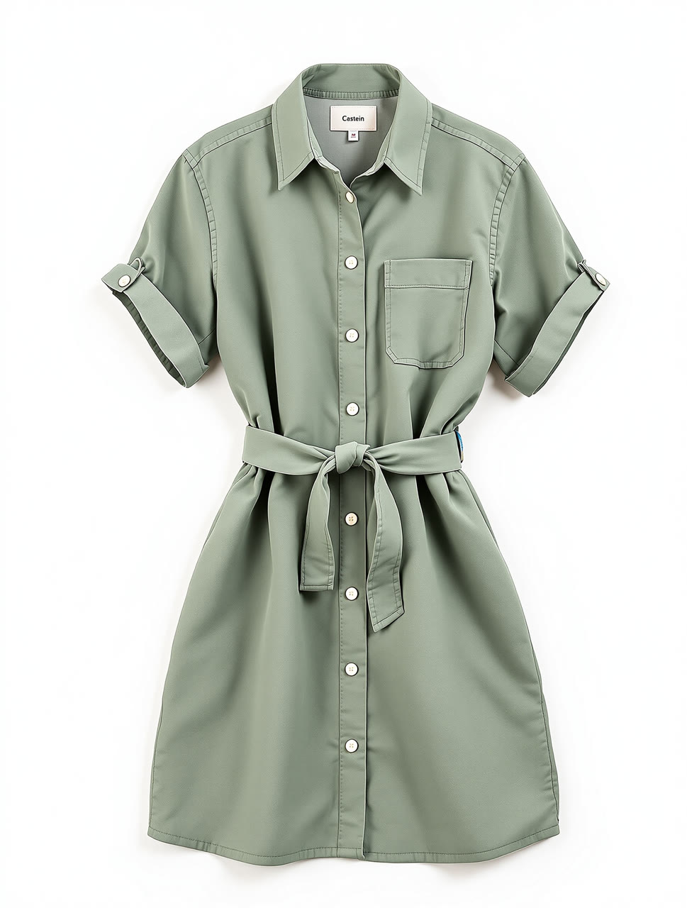
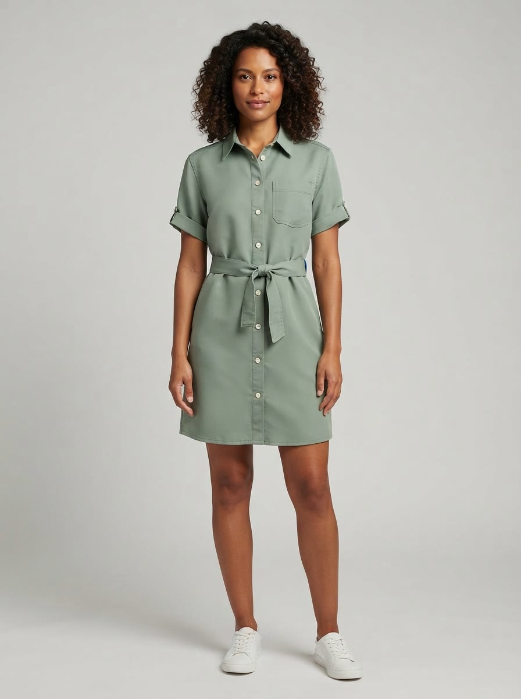
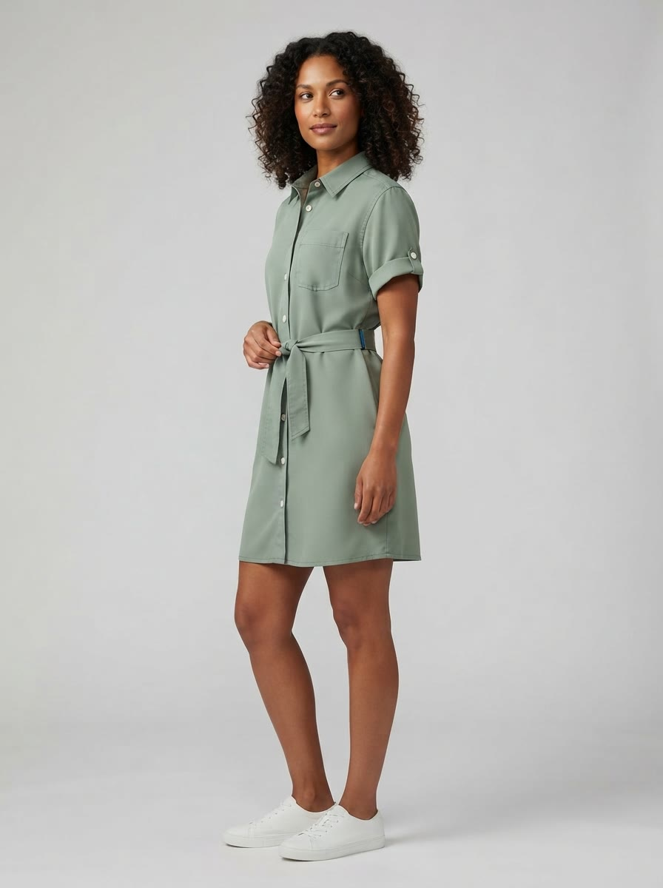
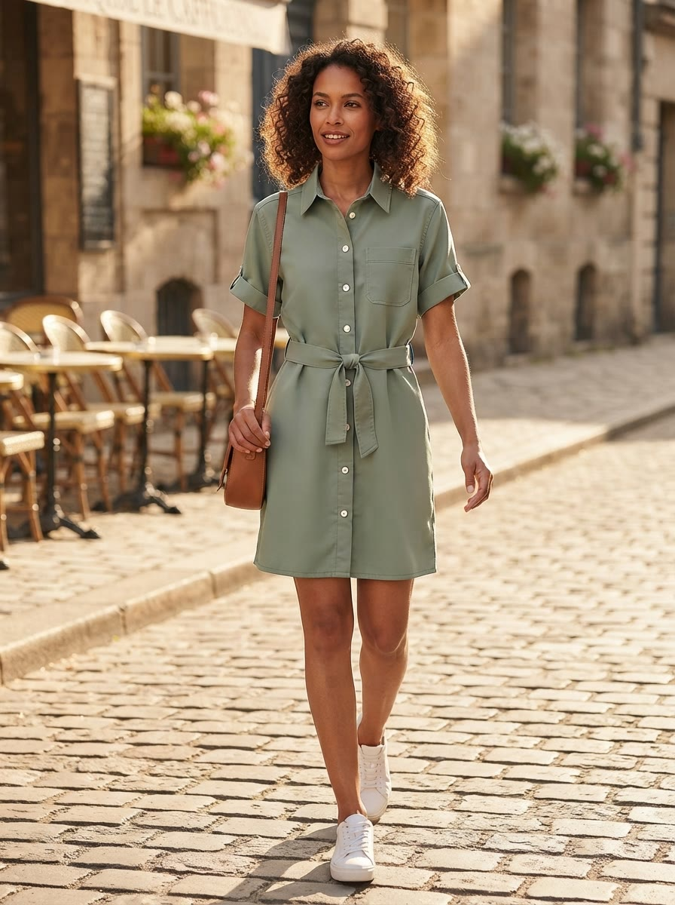

# Real run

One run of this skill's Wireflow app (`skill-ai-fashion-model-photos-for-ecommerce`, three Nano Banana Lite nodes at 3:4) on 15 October 2026.

## Input garment

To keep the repo free of anyone else's product photos, the garment was itself generated with the ai-image-generation skill (Flux Pro Ultra, 19 credits, execution `bd943436-378f-4f1b-aad3-9bafbb1f43f2`): https://cdn.wireflow.ai/a51e4e20-c858-11f1-9610-b9bcacd1d965.jpg. That render gave the dress an invented neck label ("Castein"), seven buttons and a small blue tab at the belt, so it is a fair test of whether small details survive.

## Inputs

- `garment_photo`: the URL above
- `model`: A woman in her early 30s with shoulder-length dark curly hair and warm brown skin, natural makeup, relaxed confident expression, plain white low sneakers.
- `lifestyle_setting`: Walking along a sunny cobblestone street in a European old town in late afternoon light, a cafe terrace softly blurred behind her.

Execution: `5a42acd5-388d-4b67-b8a9-5b610e6d7252`. Credits: 48 for the three images, 16 each (account balance 4,904 before, 4,856 after). Time: about 20 seconds.

## Results

All three are 896x1200 JPEGs, shown here as delivered.

| Shot | Photo | Original |
|---|---|---|
| Front |  | https://cdn.wireflow.ai/gemini-fe85fbd8-75a8-4625-9b71-5eed25f7ef98.jpg |
| Three-quarter |  | https://cdn.wireflow.ai/gemini-f670bf31-4738-4a7c-bb5e-045a30af756b.jpg |
| Lifestyle |  | https://cdn.wireflow.ai/gemini-676dd2b1-7de1-43be-8cae-a58fb57baa0f.jpg |

Honest notes: the color, point collar, white buttons, chest pocket on the wearer's left, tie belt and tab cuffs carried over in all three, and the invented neck label does not show. The model wears the dress a little shorter (above the knee) than the flat lay suggests. The small blue tab at the belt from the input reappears at the side seam in both studio shots. The lifestyle shot added a brown leather shoulder bag that nobody asked for. Each of these is the kind of miss the skill's inspection step flags before delivery.

The run used the Wireflow Apps API (`POST /api/v1/apps/skill-ai-fashion-model-photos-for-ecommerce/execute`), the same code path as the MCP `run_app` tool.
