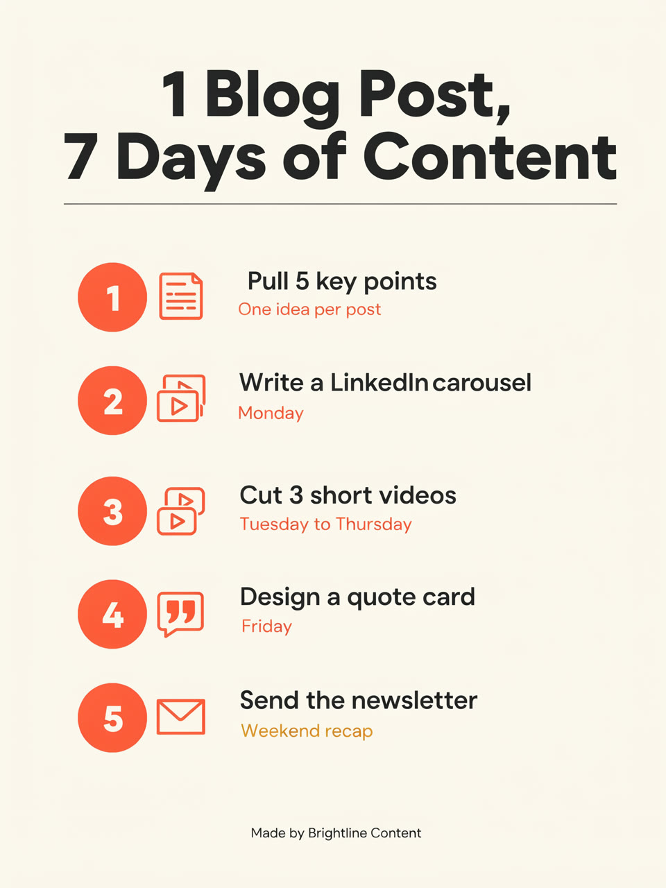
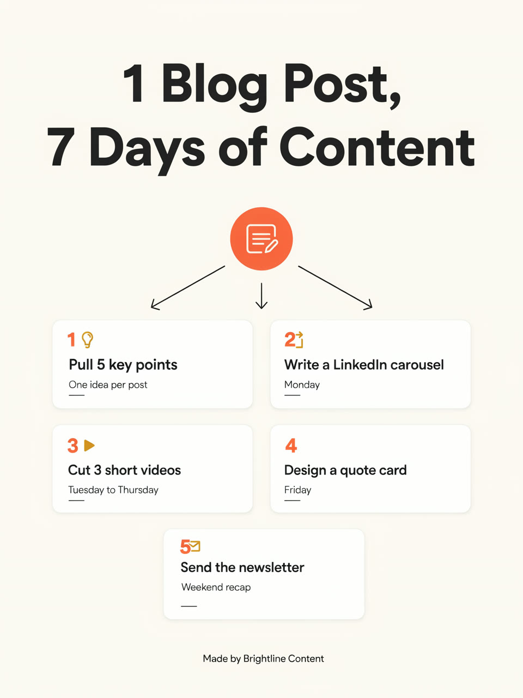

# Real run

One run of this skill's Wireflow app (`skill-ai-infographic-generator`, two Ideogram 4.5 nodes at 1728x2304) on 19 October 2026. The files here are downscaled to 960x1280; the originals are on the Wireflow CDN.

## Inputs

- `topic`: How a content agency turns one blog post into a week of social content
- `infographic_text`: Title: "1 Blog Post, 7 Days of Content". 1. "Pull 5 key points" - "One idea per post". 2. "Write a LinkedIn carousel" - "Monday". 3. "Cut 3 short videos" - "Tuesday to Thursday". 4. "Design a quote card" - "Friday". 5. "Send the newsletter" - "Weekend recap". Footer: "Made by Brightline Content".
- `style`: Warm off-white background (#FAF7F2), charcoal text (#222222), coral accent (#FF6B4A) for numbers and icons, mustard secondary accent (#F2B134), bold rounded sans serif headings, simple line icons.
- `layout_1`: Vertical numbered list down the page, a big coral number circle and a simple line icon on the left of each step, the step label in bold and its short line under it, the footer small at the bottom.
- `layout_2`: A central circle with a blog post icon at the top, five rounded cards below it arranged in a 2 column grid with the last card centered, thin arrows from the blog post icon to each card, each card with its coral number, icon, bold label and short line, the footer small at the bottom.

Execution: `c971f2d1-12d8-4787-a9fb-bad0aadc84b9`. Credits: 38 for the two images (account balance 7,926 before). Time: under a minute.

## Results

| Layout | Infographic | Original |
|---|---|---|
| Numbered vertical list |  | https://cdn.wireflow.ai/66e19df0-cb6a-11f1-944b-edf0bfd8b09f.png |
| Card grid |  | https://cdn.wireflow.ai/66ea7790-cb6a-11f1-944b-edf0bfd8b09f.png |

Honest notes: every quoted word is on both images, spelled correctly, in the right order, and no extra words appeared. Misses the skill's check step would flag: in the list layout, step 2 (the LinkedIn carousel) got a video icon, and "LinkedIn carousel" is set a little tight. In the card grid, the blog post icon has three arrows instead of one per card, and card 4 has no icon.

The run used the Wireflow Apps API (`POST /api/v1/apps/skill-ai-infographic-generator/execute`), the same code path as the MCP `run_app` tool.
