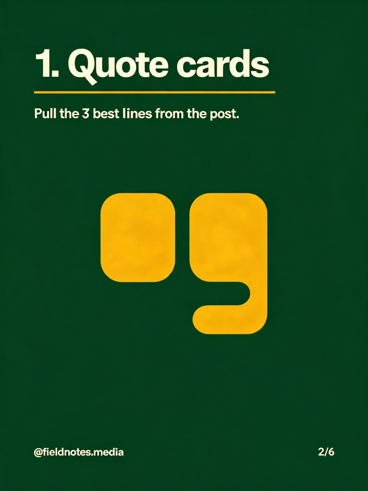
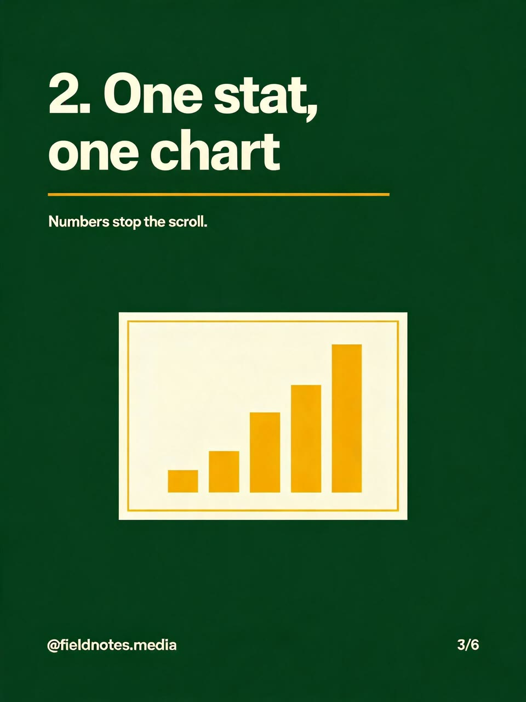
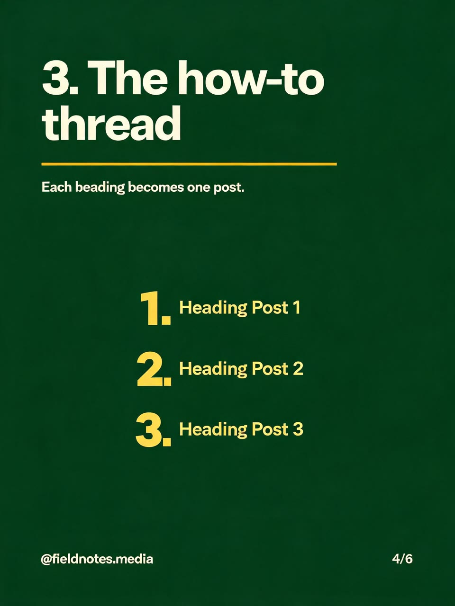
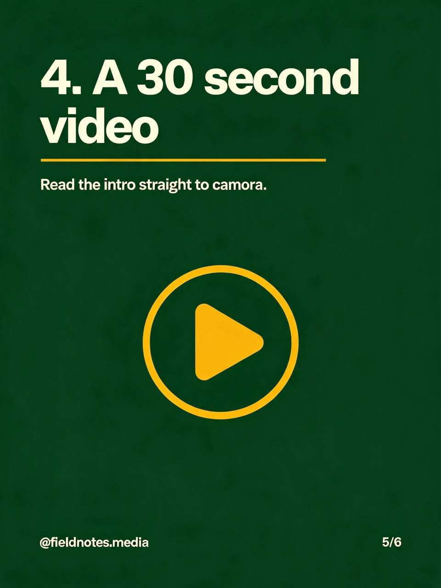

# AI Instagram Carousel Generator for Claude Code

| Cover | Point 1 | Point 2 |
|---|---|---|
|  |  |  |
| **Point 3** | **Point 4** | **Call to action** |
|  |  |  |

*Six slides, one call. Made with this skill on 16 Oct 2026: Seedream 5 Lite, 60 credits for the set. Inputs, receipt and honest notes (two small typos included) in [examples](examples/EXAMPLES.md).*

Give Claude a topic, your notes or a blog post. This AI Instagram carousel generator writes a six-slide post (a hook, four points and a call to action), sets one brand style and lets you change every word. After your yes to the quoted credits, a Wireflow app draws the cover with Seedream 5 Lite and builds the other five slides from it, so the background, colours, type and footer match across the set. Claude then reads every slide for spelling and stray words and saves the six portrait images, ready for Instagram or a LinkedIn document post.

No Wireflow connection? You still get the slide copy, a design sheet and a caption.

## Try it

```text
Turn my blog post on repurposing content into an Instagram carousel:
one post becomes quote cards, a chart, a how-to thread and a short video.
Dark green and mustard, handle @fieldnotes.media.
```

Also triggered by: "LinkedIn carousel", "swipe post", "turn this blog post into slides", "carousel in my brand colours", "multi-slide post".

## How to install

```text
/plugin marketplace add wireflowINC/skills
/plugin install wireflow-skills@wireflow
```

The plugin brings the Wireflow skills and the connector; run `/mcp`, choose `wireflow` and sign in.

Only this skill: `npx skills add wireflowINC/skills --skill ai-instagram-carousel-generator`, or copy `skills/ai-instagram-carousel-generator` into `~/.claude/skills/`, then connect Wireflow with `claude mcp add --transport http wireflow https://www.wireflow.ai/api/mcp` (Claude.ai and Desktop: custom connector, same URL).

## Works with

- **Claude Code**: where this skill is built to run, through the plugin or the skills CLI.
- **Claude.ai and Claude Desktop**: add Wireflow as a custom connector. There is no shell there to save files, so you get the slide links instead.
- **Cursor, Codex and other agents that read `SKILL.md`**: the skills CLI installs it for them. Rendering needs that agent connected to the Wireflow MCP server, and we have not tested those agents ourselves.

## Credits

| What | Credits |
|---|---|
| Slide copy, brand style, caption, quote | 0 |
| One run: all 6 slides | 60 (10 per slide, Seedream 5 Lite, measured 16 Oct 2026) |
| A redo or a second colour way | 60 more, after a yes |

Wireflow's Free plan lets you build and browse and includes a first image after setup; rendering carousels needs a paid plan, from US$24 a month (1,600 credits, about 26 carousels at this price).

## What it will not do

- Copy your logo or use your photos: the app takes text only, so add the real logo in a design tool afterwards.
- Invent statistics, results or testimonials for your slides.
- Change one slide on its own: every run renders all six.
- Render exactly 4:5: slides come out 3:4 with every word kept inside the 4:5 area, so Instagram's crop trims only plain edges.

## Data

- Your brand style and slide texts go to Wireflow through the Wireflow MCP connector (`run_app`), as you.
- Slides download from `cdn.wireflow.ai` into `./wireflow-outputs/`.
- No keys, scripts or other services.

## FAQ

### How much does one carousel cost?

60 Wireflow credits for all six slides, 10 per slide with Seedream 5 Lite (measured 16 Oct 2026). Writing the copy and the plan is free, and Claude shows the price and waits for your yes before anything renders.

### Do I need a Wireflow account?

Yes, to render: a Wireflow account with credits, connected through the Wireflow MCP connector. Without it you still get the slide copy, the design sheet and a caption.

### Which model draws the slides, and is the text spelled right?

Seedream 5 Lite. The cover is drawn from your text alone and the other five are edits of it, which keeps the set consistent. In our test all six headlines and slide numbers were exact, but two small body lines had a one-letter typo, so Claude reads every word and flags misses before you post.

### What size are the slides, and where are they saved?

Portrait 3:4 JPGs (the cover 2304x3072, the rest 1920x2560 in our test), saved in order to `./wireflow-outputs/<date>/carousel/` with the CDN links in the report. For LinkedIn, combine them into one PDF.

## In this folder

- `SKILL.md`: the procedure.
- `reference/carousel-planner.md`: the six-slide shape, copy rules, the brand style block, how to describe a slide for the app, sizes and posting, and the slide sheet.
- `examples/`: the real run, six slides and their inputs.

Built on [node based image generation](https://www.wireflow.ai/node-based-image-generation?ref=skill-ai-instagram-carousel-generator&utm_source=github&utm_medium=skill&utm_campaign=ai-instagram-carousel-generator) in [Wireflow, the AI workflow builder](https://www.wireflow.ai/ai-workflow-builder?ref=skill-ai-instagram-carousel-generator&utm_source=github&utm_medium=skill&utm_campaign=ai-instagram-carousel-generator). MIT licensed; renders use your Wireflow credits.
