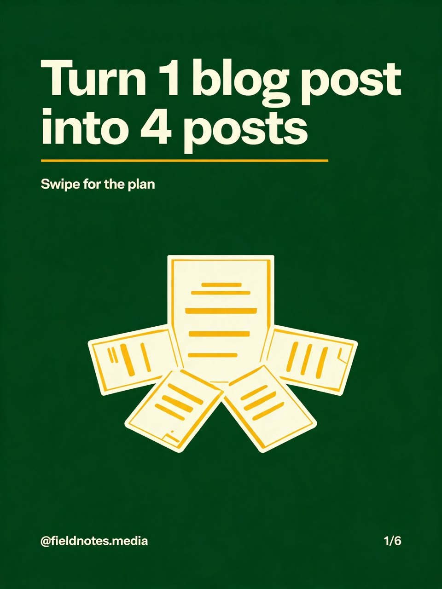
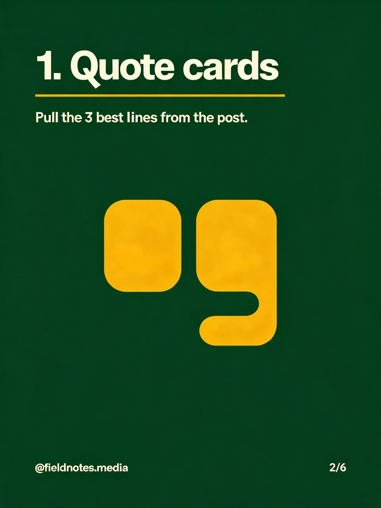
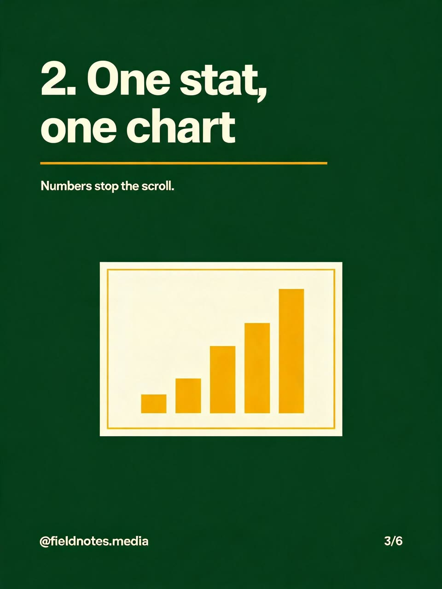
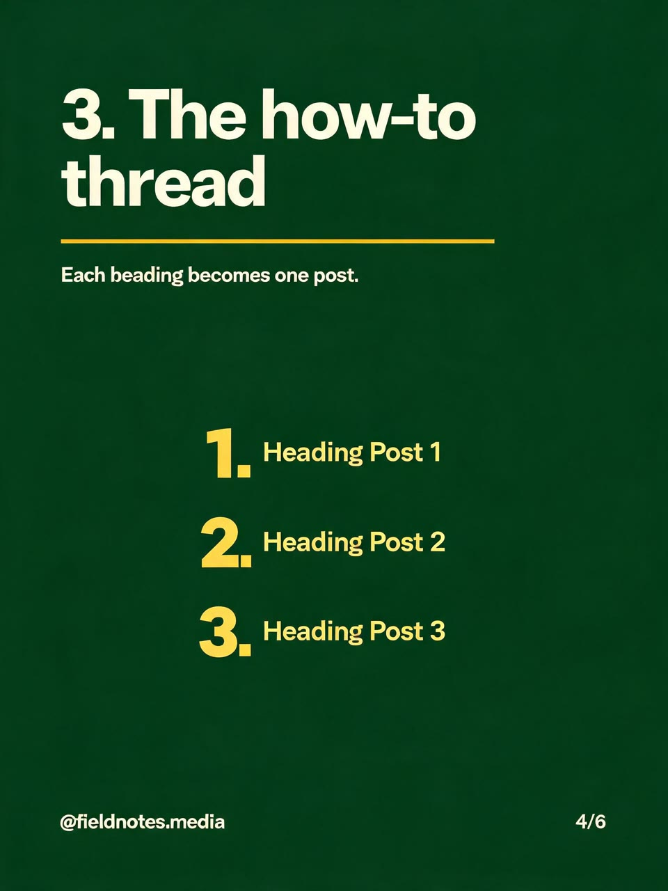
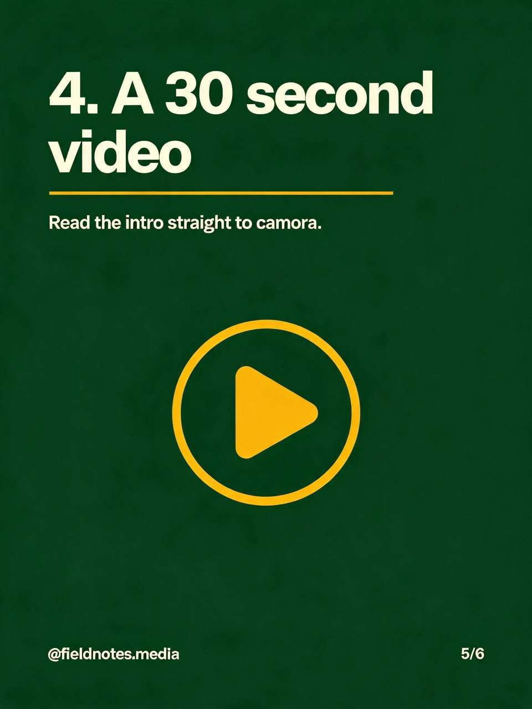
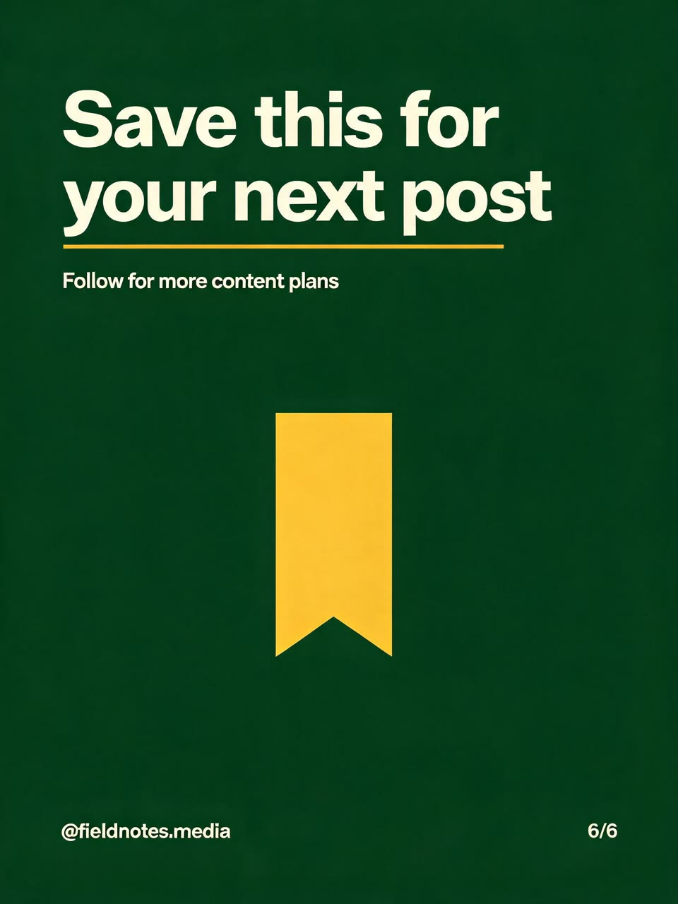

# Real run

One run of this skill's Wireflow app (`skill-ai-instagram-carousel-generator`, six Seedream 5 Lite nodes at the portrait 3:4 preset) on 16 October 2026. Slide 1 is drawn from text alone; slides 2 to 6 are edits of slide 1. The files here are downscaled to 960x1280; the originals are on the Wireflow CDN.

## Inputs

- `brand_style`: Deep forest green background (#1F3D2B), cream text (#F4EBDD), mustard yellow accent (#E3B23C) for icons and underlines, bold condensed sans serif headlines, simple flat line icons. Footer on every slide: the handle "@fieldnotes.media" small at the bottom left and the slide number small at the bottom right.
- `slide_1`: Cover slide, the hook. Big headline: "Turn 1 blog post into 4 posts". Small line under it: "Swipe for the plan". Visual: a simple flat illustration of one document splitting into four small cards. Slide number in the footer: "1/6".
- `slide_2`: Headline: "1. Quote cards". Body text: "Pull the 3 best lines from the post." Visual: a quotation mark icon. Slide number in the footer: "2/6".
- `slide_3`: Headline: "2. One stat, one chart". Body text: "Numbers stop the scroll." Visual: a simple bar chart icon. Slide number in the footer: "3/6".
- `slide_4`: Headline: "3. The how-to thread". Body text: "Each heading becomes one post." Visual: a numbered list icon. Slide number in the footer: "4/6".
- `slide_5`: Headline: "4. A 30 second video". Body text: "Read the intro straight to camera." Visual: a play button icon. Slide number in the footer: "5/6".
- `slide_6`: Last slide, the call to action. Headline: "Save this for your next post". Small line under it: "Follow for more content plans". Visual: a simple bookmark icon. Slide number in the footer: "6/6".

Execution: `8904f360-2fc3-4dd9-a704-858a000e0920`. Credits: 60 for the six slides (account balance 2,726 before, 2,666 after). Time: about 90 seconds.

## Results

| Slide | Image | Original |
|---|---|---|
| 1, cover |  | https://cdn.wireflow.ai/4adbfea0-c90f-11f1-841b-f3b9d1349239.jpg |
| 2 |  | https://cdn.wireflow.ai/6369da50-c90f-11f1-841b-f3b9d1349239.jpg |
| 3 |  | https://cdn.wireflow.ai/64a51970-c90f-11f1-841b-f3b9d1349239.jpg |
| 4 |  | https://cdn.wireflow.ai/62cc61d0-c90f-11f1-841b-f3b9d1349239.jpg |
| 5 |  | https://cdn.wireflow.ai/6371f0a0-c90f-11f1-841b-f3b9d1349239.jpg |
| 6, call to action |  | https://cdn.wireflow.ai/637265d0-c90f-11f1-841b-f3b9d1349239.jpg |

Honest notes: the six slides read as one set (same green background, cream headlines, mustard underline, handle and footer), every headline is spelled exactly, and the slide numbers run 1/6 to 6/6. Three misses, all in small text, which the skill's check step exists to catch:

- Slide 4's body line says "Each beading becomes one post." instead of "heading".
- Slide 5's body line says "straight to camora." instead of "camera".
- Slide 4's "numbered list icon" came back as a list with the made-up words "Heading Post 1", "Heading Post 2" and "Heading Post 3". The skill now asks for wordless visuals ("a list icon with three bullet lines, no letters or numbers").

Slide 1 came back at 2304x3072 and slides 2 to 6 at 1920x2560: all are 3:4, so they line up in a carousel. On a plain background, either typo is a quick patch in a design tool; a re-run is another 60 credits.

The run used the Wireflow Apps API (`POST /api/v1/apps/skill-ai-instagram-carousel-generator/execute`), the same code path as the MCP `run_app` tool.
