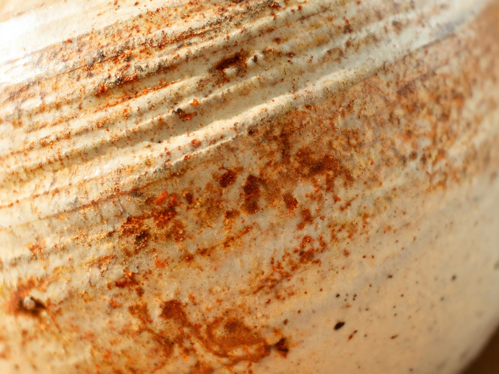
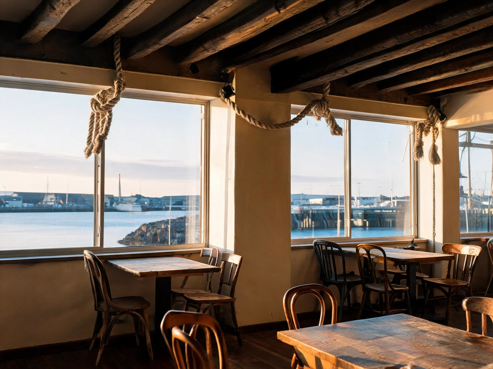
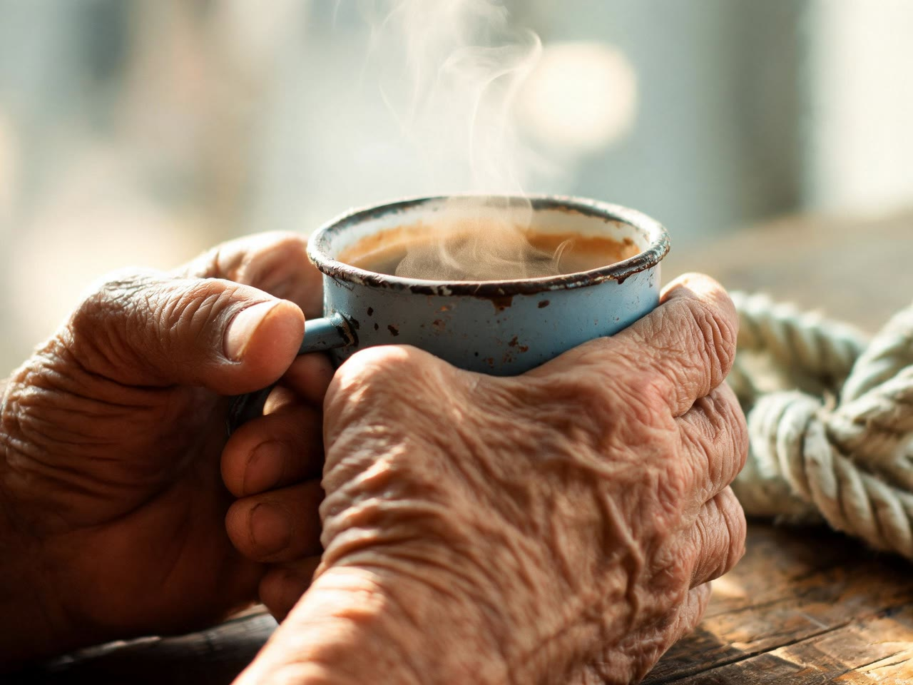

# AI Mood Board Generator for Claude Code

| Hero | Texture |
|---|---|
|  |  |
| **Place** | **Detail** |
|  |  |

*One run: four images and a direction note for a harbour town coffee roaster pitch. Made with this skill on 2 Nov 2026: Seedream 5 Lite, 43 credits. Inputs, note, receipt and honest notes in [examples](examples/EXAMPLES.md).*

This AI mood board generator is for the moment before a campaign has scenes: you know the client and the feeling, and you need a look to put in front of them. Tell Claude about the brief. Claude shapes it into inputs and quotes the credits; after your yes, one Wireflow app run writes a direction note (the idea, a palette with hex codes, tone, what to avoid) and draws four landscape pictures in that look: a hero, a texture close-up, a place and a detail. Want to compare directions? Each extra route is one more run.

No Wireflow connection? Claude still writes the direction note and four image prompts for a designer or any image tool.

## Try it

```text
Make a mood board for a pitch next week: a family-run coffee roaster
from a harbour town opening its first city cafe. Salty, warm, handmade.
Think fishing boats and enamel mugs, nothing dark or luxury.
```

Also triggered by: "visual direction for this campaign", "moodboard for a client pitch", "look and feel options", "style exploration", "give me three creative routes".

## How to install

```text
/plugin marketplace add wireflowINC/skills
/plugin install wireflow-skills@wireflow
```

The plugin brings the Wireflow skills and the connector; run `/mcp` → `wireflow` → sign in.

Only this skill: `npx skills add wireflowINC/skills --skill ai-mood-board-generator`, or copy `skills/ai-mood-board-generator` into `~/.claude/skills/`, then add the connector with `claude mcp add --transport http wireflow https://www.wireflow.ai/api/mcp` (Claude.ai and Desktop: custom connector, same URL).

## Works with

- **Claude Code**: where this skill is built to run. Install the plugin or use the skills CLI.
- **Claude.ai and Claude Desktop**: add Wireflow as a custom connector. Without a shell you get the image links instead of saved files.
- **Cursor, Codex and other agents that read `SKILL.md`**: the skills CLI installs it there. Generation needs that agent connected to the Wireflow MCP server; we have not tested those agents ourselves.

## Credits

| What | Credits |
|---|---|
| Brief, routes, quote | 0 |
| One route: four images and a note | 43 (10 per Seedream 5 Lite image + 3 for the direction step, measured 2 Nov 2026) |
| Three routes to compare | 129, quoted once before the batch |

Wireflow's Free plan lets you build and browse and includes a first image after setup; regular rendering needs a paid plan, from US$24 a month.

## What it will not do

- Lay the pictures out on one page: you get four separate files and a note, ready to drop into Figma, Keynote or your pitch deck.
- Read your reference images: the app takes words only, so describe what you like.
- Apply an existing brand. `brand-consistent-images` does that; this one explores a new look.
- Plan a sequence of scenes. That is `ai-storyboard-generator`.
- Put words, logos, real people or real brands in the pictures.

## Data

- The brief, mood words and reference notes go to Wireflow through the Wireflow MCP connector (`run_app`), as you.
- Images download from `cdn.wireflow.ai` into `./wireflow-outputs/`.
- No keys, scripts or other services.

## FAQ

### How much does one board cost?

43 Wireflow credits for a route: 10 for each of the four Seedream 5 Lite images and 3 for the step that writes the direction (measured 2 Nov 2026). Shaping the brief is free, and Claude quotes the total and waits for your yes.

### Do I need a Wireflow account?

Yes, to generate images: a Wireflow account with credits, connected through the Wireflow MCP connector (sign-in, no keys). Without it you still get a written direction note and four prompts.

### Which models does it use?

Claude Haiku 4.5 inside the app writes the note and the four prompts. Seedream 5 Lite draws the first image, then uses it as the reference for the other three so medium, palette and light stay the same.

### Can I show it pictures I like?

Not yet. Inputs are text only, so describe the era, place, materials and light you like. Claude helps turn a named reference into plain words.

### Where do the files go?

To `./wireflow-outputs/<date>/mood-boards/<route>/`: four landscape 4:3 JPGs (2560x1920 or larger) and `direction-note.md`, with the CDN links in the report.

## In this folder

- `SKILL.md`: the procedure.
- `reference/direction-guide.md`: how to write briefs and mood words, how to make routes differ, and the free written version.
- `examples/`: the real run, all four images, the note and the inputs.

Powered by [node based image generation](https://www.wireflow.ai/node-based-image-generation?ref=skill-ai-mood-board-generator&utm_source=github&utm_medium=skill&utm_campaign=ai-mood-board-generator) on [Wireflow, the node-based AI workflow platform](https://www.wireflow.ai/features/best-node-based-ai-workflow-platform?ref=skill-ai-mood-board-generator&utm_source=github&utm_medium=skill&utm_campaign=ai-mood-board-generator). MIT licensed; renders use your Wireflow credits.
