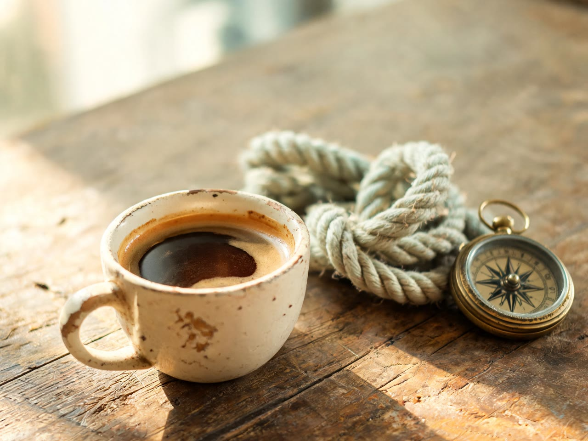
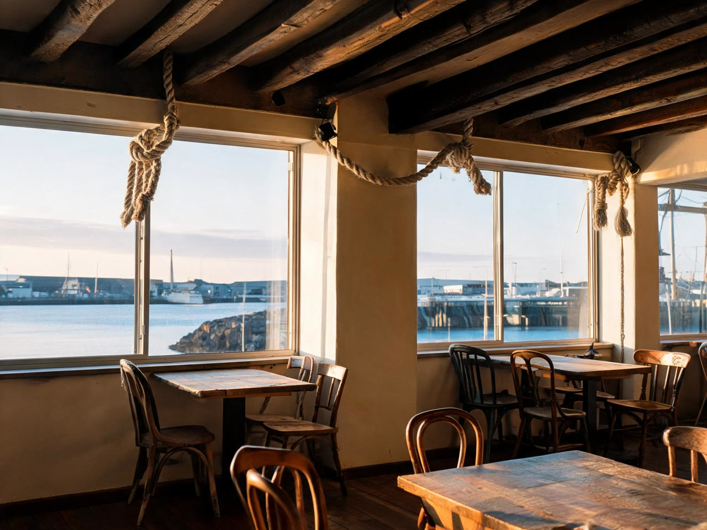
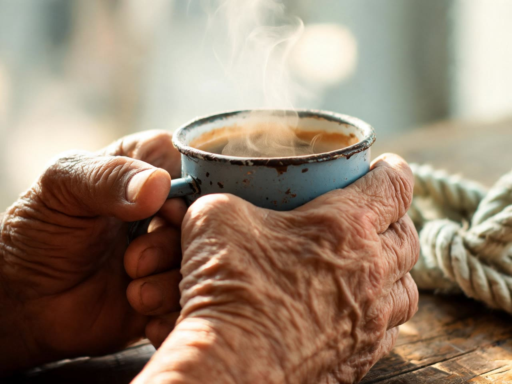

# Real run

One run of this skill's Wireflow app (`skill-ai-mood-board-generator`: Run any LLM with Claude Haiku 4.5, then four Seedream 5 Lite nodes at landscape 4:3) on 2 November 2026. The files here are downscaled to 1280 px wide; the originals are on the Wireflow CDN.

## Inputs

- `campaign_brief`: Pitch for a family-run coffee roaster in a small harbour town that is opening its first city cafe. The agency needs a new visual direction for a spring campaign aimed at people in their 30s who are tired of slick chain cafes.
- `mood_words`: Salty, warm, handmade, a little weathered, optimistic.
- `reference_notes`: Fishing boats, enamel mugs, faded rope, 1960s travel posters, early morning sea light. Avoid anything dark, moody or luxury.

## Outputs

`direction-note`, as returned:

> Coastal craft meets urban warmth. A sun-bleached, handmade aesthetic that brings harbour-town authenticity to the city, celebrating slow mornings and honest craftsmanship. Palette: Seafoam #A8D5BA, Warm Cream #F5E6D3, Rust Orange #D97E4A, Soft Grey #9B8B7E, Salt White #FAFAF8. Tone: Optimistic, tactile, unhurried, genuine. Avoid: Sleek minimalism, dark moods, luxury finishes, corporate polish, artificial styling.

| Image | Picture | Original |
|---|---|---|
| 1 Hero (3072x2304) |  | https://cdn.wireflow.ai/a8c1b2e0-d66a-11f1-adcc-f953529b66a0.jpg |
| 2 Texture (2560x1920) |  | https://cdn.wireflow.ai/bcd7e920-d66a-11f1-adcc-f953529b66a0.jpg |
| 3 Place (2560x1920) |  | https://cdn.wireflow.ai/c1cc5fb0-d66a-11f1-adcc-f953529b66a0.jpg |
| 4 Detail (2560x1920) |  | https://cdn.wireflow.ai/bf4e1940-d66a-11f1-adcc-f953529b66a0.jpg |

- Execution: `8b2f9252-2408-4be7-9ffa-c6cc4ca3e97a`
- Credits: 43, from `GET /credits/history`: Openrouter Router 3, one Seedream V5 Lite charge of 10, then three Seedream V5 Lite Edit charges of 10. The balance went from 1,087 to 1,044.
- Time: about a minute. Image 1 finished first, then the other three together.

Honest notes: the four read as one look, with the same warm low sun, worn surfaces and rope carried through. The palette leans browner than the note says; seafoam shows up only in the rope and the mug. Image 1 added a brass compass nobody asked for, and its dial has small letter-like marks, the one place the no-text rule slipped. The cup changes from cream ceramic in image 1 to blue enamel in image 4, which suits a direction board but would not suit a product set. In image 3 the knots hanging at the windows are a little odd as decor, and two small black fittings sit under the ceiling beams. This is the only test so far: one brief, one run, so we can't say how often the look holds.

The run used the Wireflow Apps API (`POST /api/v1/apps/skill-ai-mood-board-generator/execute`), the same code path as the MCP `run_app` tool.
