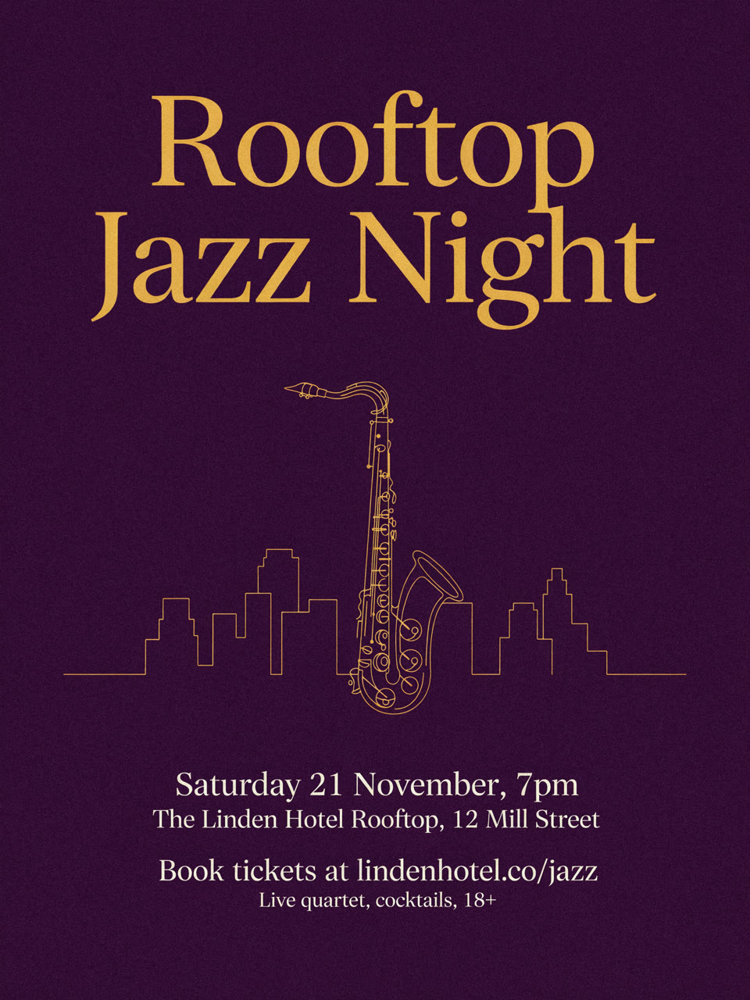
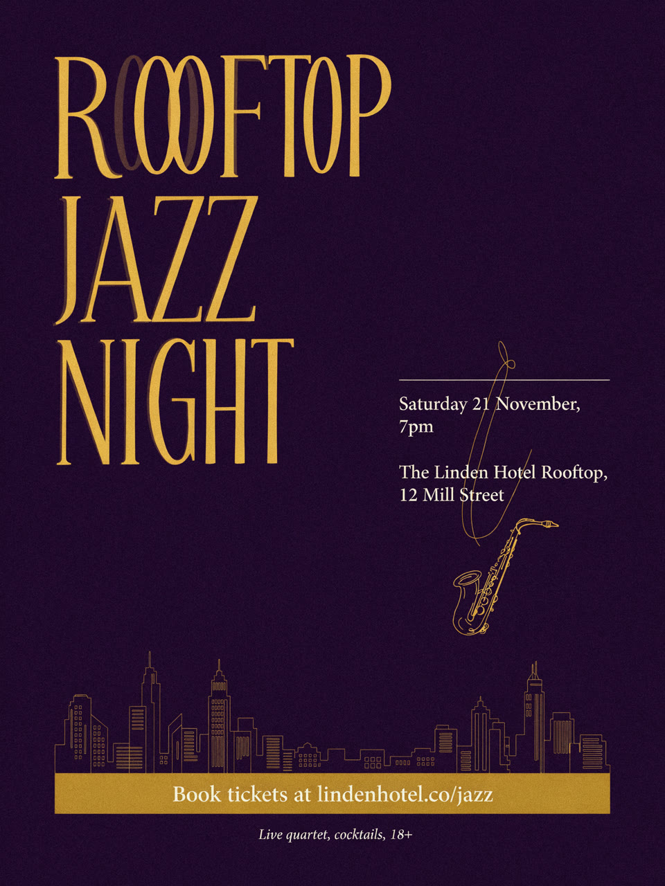

# Real run

One run of this skill's Wireflow app (`skill-ai-poster-generator`, two Ideogram 4.5 nodes) on 3 November 2026, for a made-up hotel event. The files here are downscaled to 1280 pixels on the long edge; the 1728x2304 originals are on the Wireflow CDN.

## Inputs

- `poster_text`: Headline: "Rooftop Jazz Night". Date: "Saturday 21 November, 7pm". Venue: "The Linden Hotel Rooftop, 12 Mill Street". Call to action: "Book tickets at lindenhotel.co/jazz". Small print: "Live quartet, cocktails, 18+".
- `brand_colors`: Deep plum background (#3B1F3A), gold headline (#E8B04B), cream text (#F6EFE3).
- `style`: Art deco music poster, elegant tall serif headline, thin gold line art of a saxophone and a city skyline, subtle paper grain.
- `layout_1`: Headline large across the top third, saxophone line art centered in the middle, date, venue and call to action stacked and centered in the bottom third.
- `layout_2`: Skyline line art along the bottom edge, headline set vertically stacked on the left half, date and venue in a right-hand column, call to action in a gold band near the foot.

Execution: `3f6b5c92-e4d9-4917-b57b-3b672b983ce4`. Credits: 38 for the two posters (balance 7,114 before, 7,076 after). Time: about a minute.

## Results

| Option | Poster | Original |
|---|---|---|
| Layout 1 |  | https://cdn.wireflow.ai/047a8bc0-d733-11f1-91ec-4530b0d51613.png |
| Layout 2 |  | https://cdn.wireflow.ai/04827b00-d733-11f1-91ec-4530b0d51613.png |

Honest notes, from proofing both against the approved text:

- **Layout 1:** all five pieces are there and spelled exactly, in the right order of size, clear of the edges. Ready to send for approval.
- **Layout 2:** every word is spelled right, but the headline "ROOFTOP" has a faint shadow copy behind the two O's, and a loose gold line from the saxophone art runs through the date and venue. The headline is set in capitals, which the brief allowed but did not ask for. This option would need a re-run before it goes to print.
- 21 November 2026 is a Saturday, so the weekday is correct.

This was the only test run. Layout 2 was not re-rendered.

The run used the Wireflow Apps API (`POST /api/v1/apps/skill-ai-poster-generator/execute`), the same code path as the MCP `run_app` tool.
