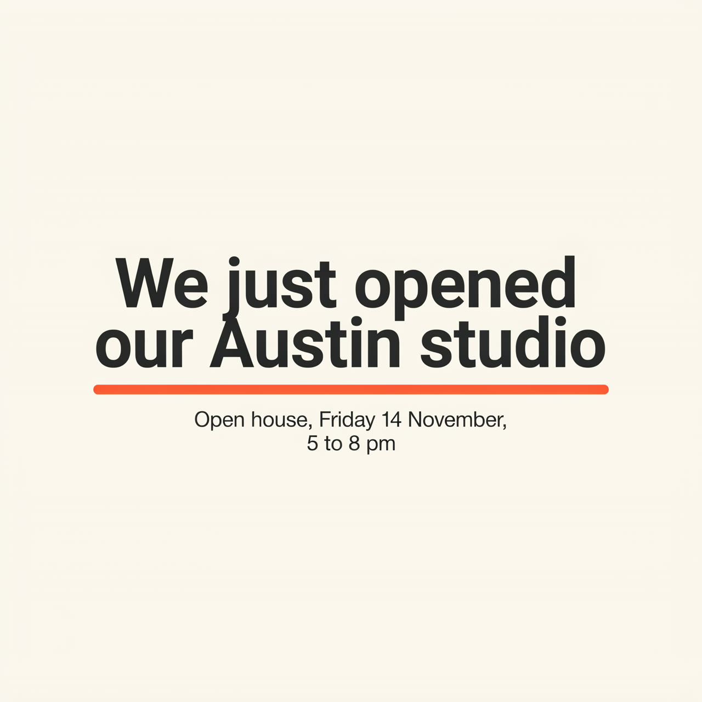
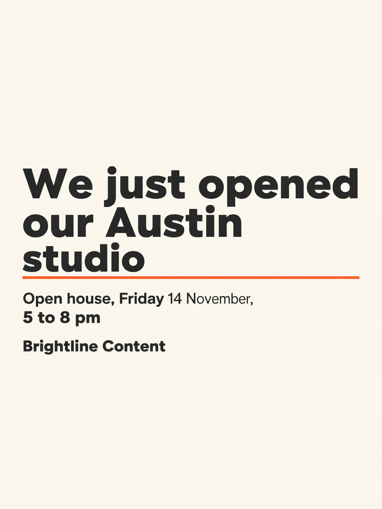
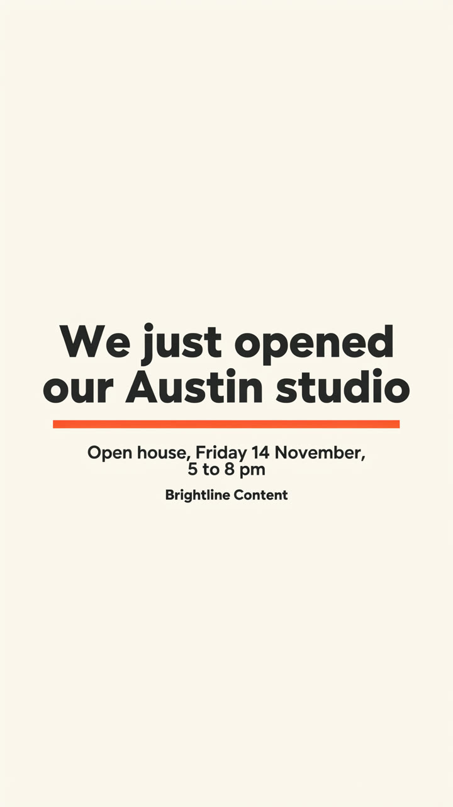

# AI Social Media Graphics for Claude Code

| Square | Portrait | Story |
|---|---|---|
|  |  |  |

*One post, three sizes, one call. Made with this skill on 2 Nov 2026: Ideogram 4.5, 57 credits for all three. The square dropped its footer and the portrait has a weight slip; see the unedited run and honest notes in [examples](examples/EXAMPLES.md).*

Tell Claude what the post says: a client quote, one strong number or an announcement. These AI social media graphics are single text posts, built for agencies that need a lot of them. Claude trims the words, agrees every piece of text with you and quotes the credits. After your yes, a Wireflow app draws the post at feed square, tall portrait and story sizes in your brand colors. Claude then opens all three, compares them with the approved text and tells you what went wrong before you schedule anything.

No Wireflow connection? You still get a post sheet and a design spec a designer can build.

## Try it

```text
Make a stat post for our client Fernhill Dental: "92% of new patients
booked online" from their 2026 booking report. Teal background, white
text, friendly rounded font. Feed and stories, please.
```

Also triggered by: "quote card", "stat post", "announcement graphic", "branded text post", "event post", "same post for feed and stories".

## How to install

```text
/plugin marketplace add wireflowINC/skills
/plugin install wireflow-skills@wireflow
```

The plugin brings the Wireflow skills and the connector; run `/mcp` → `wireflow` → sign in.

Only this skill: `npx skills add wireflowINC/skills --skill ai-social-media-graphics`, or copy `skills/ai-social-media-graphics` into `~/.claude/skills/`, then add the connector with `claude mcp add --transport http wireflow https://www.wireflow.ai/api/mcp` (Claude.ai and Desktop: custom connector, same URL).

## Works with

- **Claude Code**: where this skill is built to run. Install the plugin or use the skills CLI.
- **Claude.ai and Claude Desktop**: add Wireflow as a custom connector. Saving files needs a shell, so there you get the image links instead.
- **Cursor, Codex and other agents that read `SKILL.md`**: the skills CLI installs it there. Rendering needs that agent connected to the Wireflow MCP server; we have not tested those agents ourselves.

## Credits

| What | Credits |
|---|---|
| Words, layout, quote | 0 |
| One post in 3 sizes | 57 (19 per image, Ideogram 4.5, measured 2 Nov 2026) |
| A fix or another post | 57 more, after a yes |

Wireflow's Free plan lets you build and browse and includes a first image after setup; rendering these posts needs a paid plan, from US$24 a month.

## What it will not do

- Invent quotes, statistics or sources. Every word comes from you or a source you give.
- Place a real logo file: the app takes text only, so a brand name appears as typed text.
- Render a true 4:5 file: Ideogram 4.5 has no such size, so portrait is 3:4, with the words kept clear of the area a 4:5 crop removes.
- Promise every word lands on every size. Each size is drawn on its own, so Claude checks all three and names any miss.
- Build a multi-slide story (use `ai-instagram-carousel-generator`) or a paid product ad (use `ai-ad-creative-generator`).

## Data

- The post text, post type and brand colors go to Wireflow through the Wireflow MCP connector (`run_app`), as you.
- Images download from `cdn.wireflow.ai` into `./wireflow-outputs/`.
- No keys, scripts or other services.

## FAQ

### How much does a social media graphic cost?

One post in all three sizes is 57 Wireflow credits, 19 per image with Ideogram 4.5 (measured 2 Nov 2026). Agreeing the words is free. Claude quotes the cost and waits for your yes before anything renders. The app always draws the full set, so one size costs the same as three.

### Do I need a Wireflow account?

Yes, to render: a Wireflow account with credits, connected through the Wireflow MCP connector. Without it you still get the post sheet and the design spec.

### Which model draws it, and is the text spelled right?

Ideogram 4.5, picked for clean lettering, with prompt rewriting off. In our test every word it drew was spelled correctly, but the square left out the small footer. That is why Claude reads all three images against your approved text and flags any miss before you schedule.

### What sizes do I get, and where do the files go?

PNG files at 2048x2048 (square), 1728x2304 (3:4 portrait) and 1440x2560 (9:16 story). They are saved to `./wireflow-outputs/<date>/social-graphics/`, with the CDN links in the report.

## In this folder

- `SKILL.md`: the procedure.
- `reference/post-sheet.md`: post types, word rules, the post sheet, the design spec and the 4:5 crop.
- `examples/`: the real run, three images and the inputs.

Powered by [node based image generation](https://www.wireflow.ai/node-based-image-generation?ref=skill-ai-social-media-graphics&utm_source=github&utm_medium=skill&utm_campaign=ai-social-media-graphics) on [Wireflow, the node-based AI workflow platform](https://www.wireflow.ai/features/best-node-based-ai-workflow-platform?ref=skill-ai-social-media-graphics&utm_source=github&utm_medium=skill&utm_campaign=ai-social-media-graphics). MIT licensed; renders use your Wireflow credits.
