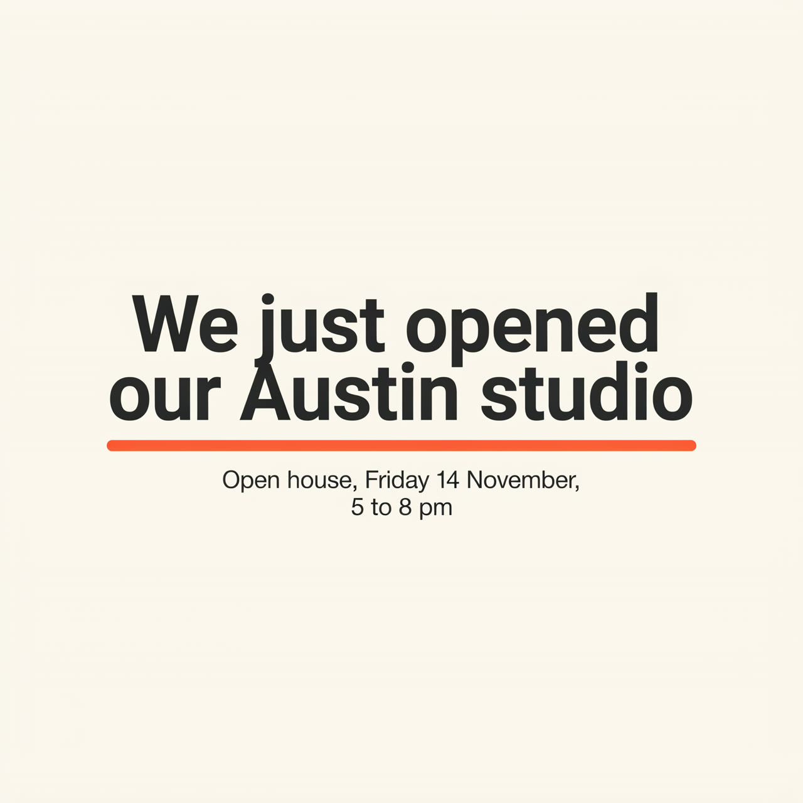
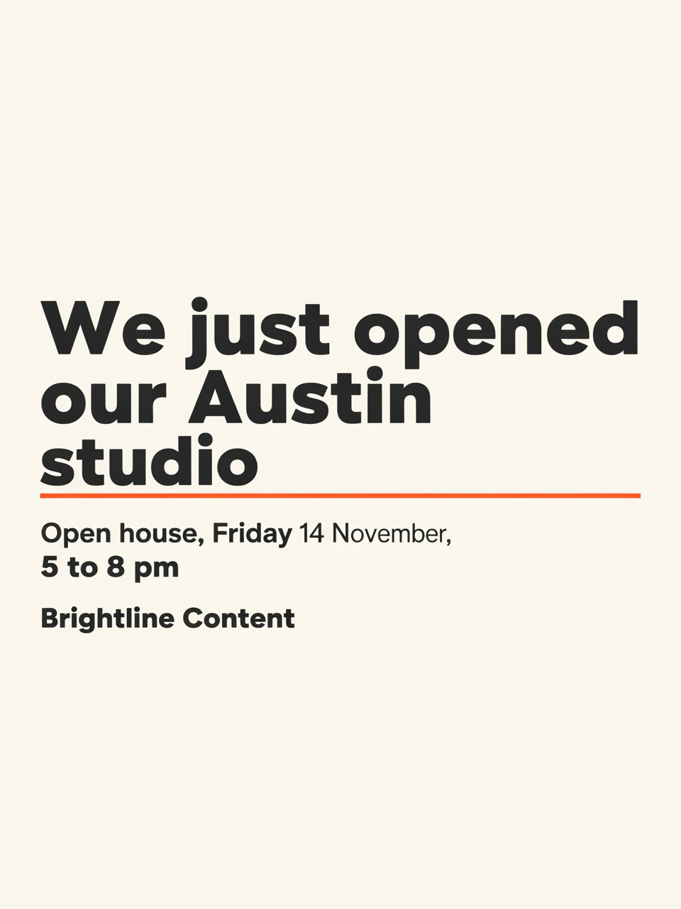
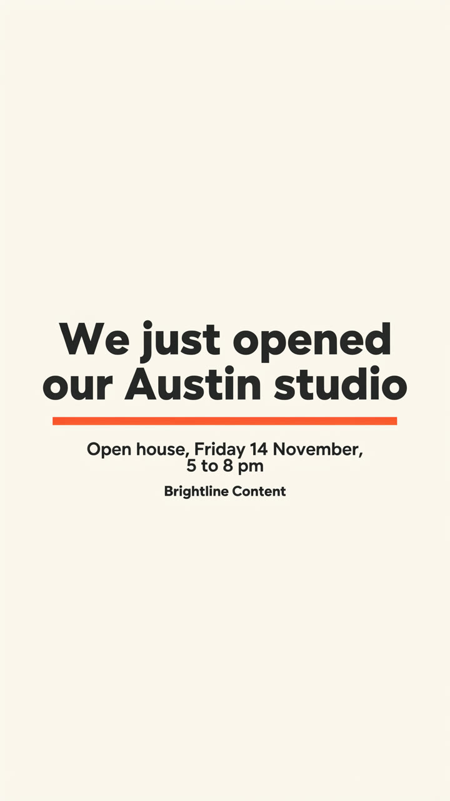

# Real run

One run of this skill's Wireflow app (`skill-ai-social-media-graphics`, three Ideogram 4.5 nodes) on 2 November 2026, for a made-up agency. The files here are downscaled to 1280 pixels on the long edge; the originals are on the Wireflow CDN.

## Inputs

- `post_text`: Headline: "We just opened our Austin studio". Detail: "Open house, Friday 14 November, 5 to 8 pm". Footer: "Brightline Content"
- `post_type`: Announcement: the headline as the hero in very big type, the detail line smaller underneath it, the footer small at the bottom of the text block, one coral underline under the headline as the only accent.
- `brand_colors`: Warm off-white background (#FAF7F2), charcoal text (#222222), coral accent (#FF6B4A), bold rounded sans serif.

Execution: `9b8595c5-c69d-47c4-8421-89fa04c459a7`. Credits: 57 for the three images, 19 each in the account's credit history. Time: about a minute.

## Results

| Size | Graphic | Original |
|---|---|---|
| Square 2048x2048 |  | https://cdn.wireflow.ai/d05a1230-d669-11f1-adcc-f953529b66a0.png |
| Portrait 1728x2304 |  | https://cdn.wireflow.ai/d051d4d0-d669-11f1-adcc-f953529b66a0.png |
| Story 1440x2560 |  | https://cdn.wireflow.ai/cfb65820-d669-11f1-adcc-f953529b66a0.png |

Honest notes: what was drawn is spelled correctly on all three, and no extra words appeared. These are the misses the skill's check step would flag:

- **Square:** the footer "Brightline Content" is missing, so this image would not be ready to schedule. The tail of the "j" in "just" also touches the "A" in "Austin" on the line below.
- **Portrait:** "14 November," is set in a lighter weight than the rest of its line. The layout is left aligned, while the other two sizes are centered.
- **Story:** no misses. The words stay inside the middle of the frame, clear of the app buttons.
- **All three:** the input itself has a slip. 14 November 2026 is a Saturday, not a Friday. The app drew it as typed, and the skill now checks weekday and date before it quotes. The event is made up, so nothing depends on it.

This was the only test run. The misses above were not re-rendered.

The run used the Wireflow Apps API (`POST /api/v1/apps/skill-ai-social-media-graphics/execute`), the same code path as the MCP `run_app` tool.
