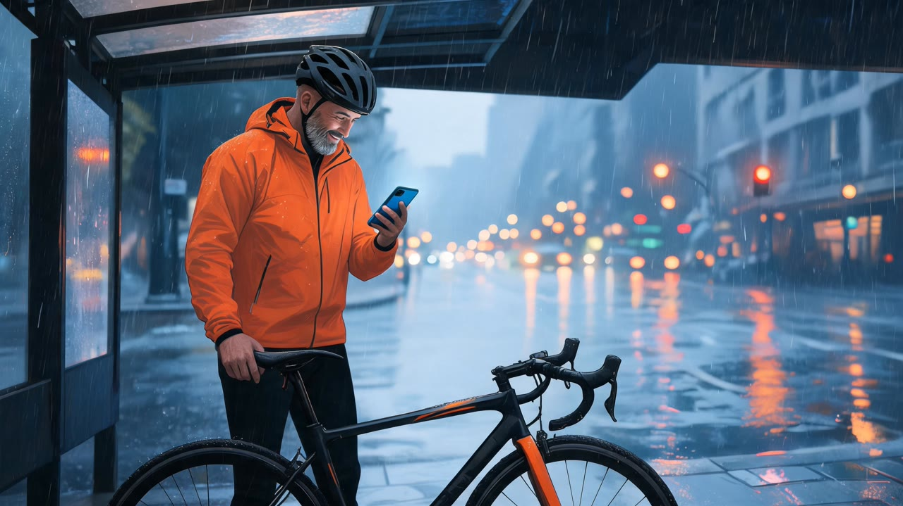
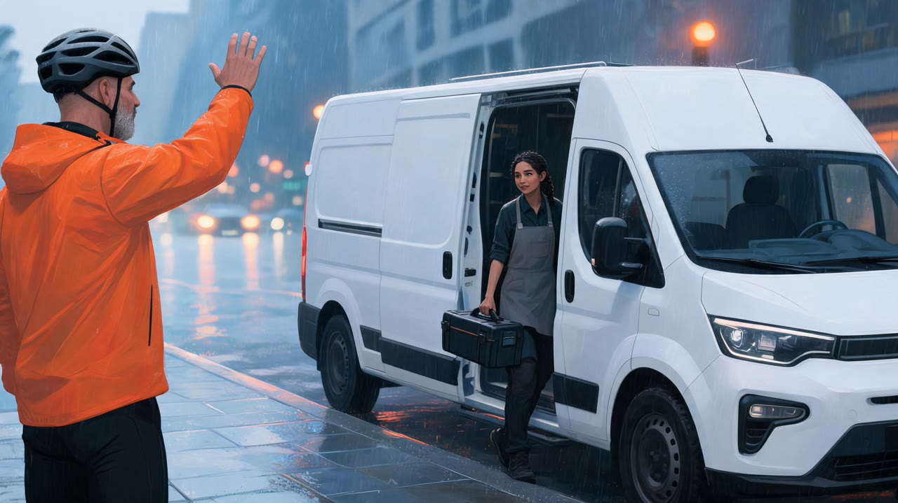

# AI Storyboard Generator for Claude Code

| Open | Problem | Turn |
|---|---|---|
|  |  |  |
| **Help arrives** | **The fix** | **Payoff** |
|  |  |  |

*Six frames, one call. Made with this skill on 21 Oct 2026: Seedream 5 Lite, 60 credits for the board. Inputs, receipt and honest notes (one side character drifted) in [examples](examples/EXAMPLES.md).*

Give Claude a script, an ad brief or a one-line pitch idea. This AI storyboard generator breaks it into six shots with real camera directions, writes one note for your main character and one for the look, and lets you change any of it. After your yes to the quoted credits, a Wireflow app paints the opening frame with Seedream 5 Lite and builds the other five from it, so the same person in the same outfit and the same style carry through every panel while the camera moves. Claude checks each frame against the plan and saves the six 16:9 images with a shot list you can drop into a client deck or hand to a video model.

No Wireflow connection? You still get the shot list and a prompt for every frame.

## Try it

```text
Storyboard a 30 second ad for a mobile bike repair service:
a cyclist gets a flat in the rain, books a mechanic on his phone,
she arrives in a van, fixes it, he rides off. Painted, moody, orange accents.
```

Also triggered by: "storyboard this script", "shot list with frames", "frames for a client pitch", "plan a TikTok ad", "storyboard for an AI video".

## How to install

```text
/plugin marketplace add wireflowINC/skills
/plugin install wireflow-skills@wireflow
```

The plugin brings the Wireflow skills and the connector; run `/mcp`, choose `wireflow` and sign in.

Only this skill: `npx skills add wireflowINC/skills --skill ai-storyboard-generator`, or copy `skills/ai-storyboard-generator` into `~/.claude/skills/`, then connect Wireflow with `claude mcp add --transport http wireflow https://www.wireflow.ai/api/mcp` (Claude.ai and Desktop: custom connector, same URL).

## Works with

- **Claude Code**: where this skill is built to run, through the plugin or the skills CLI.
- **Claude.ai and Claude Desktop**: add Wireflow as a custom connector. There is no shell there to save files, so you get the frame links instead.
- **Cursor, Codex and other agents that read `SKILL.md`**: the skills CLI installs it for them. Rendering needs that agent connected to the Wireflow MCP server, and we have not tested those agents ourselves.

## Credits

| What | Credits |
|---|---|
| Shot list, style and character notes, quote | 0 |
| One run: all 6 frames | 60 (10 per frame, Seedream 5 Lite, measured 21 Oct 2026) |
| A redo or a second look | 60 more, after a yes |

Wireflow's Free plan lets you build and browse and includes a first image after setup; rendering storyboards needs a paid plan, from US$24 a month (1,600 credits, about 26 storyboards at this price).

## What it will not do

- Use photos, logos or real people: the app takes text only, so describe the product and add brand marks in the edit.
- Put captions, arrows or panel numbers in the frames: those go in the shot list next to them.
- Change one panel on its own: every run paints all six.
- Lock side characters: only the hero is carried from panel 1, so Claude repeats every other person's description in each panel.

## Data

- Your style, character and panel texts go to Wireflow through the Wireflow MCP connector (`run_app`), as you.
- Frames download from `cdn.wireflow.ai` into `./wireflow-outputs/`.
- No keys, scripts or other services.

## FAQ

### How much does one storyboard cost?

60 Wireflow credits for all six frames, 10 per frame with Seedream 5 Lite (measured 21 Oct 2026). Planning the shots is free, and Claude shows the price and waits for your yes before anything renders.

### Do I need a Wireflow account?

Yes, to render: a Wireflow account with credits, connected through the Wireflow MCP connector. Without it you still get the shot list and the frame prompts.

### Which model draws the frames, and does the character stay the same?

Seedream 5 Lite. Panel 1 is drawn from your text and panels 2 to 6 use it as the reference, so the hero's face, hair and outfit and the art style hold across the board. In our test the hero matched in all six; a mechanic described only once changed between panels, so Claude now describes side characters in every panel.

### What size are the frames, and where are they saved?

Landscape 16:9 JPGs (3072x1728 for panel 1 and 3416x1920 for the rest in our test), saved in order to `./wireflow-outputs/<date>/storyboard/` with a `storyboard.md` shot list and the CDN links.

## In this folder

- `SKILL.md`: the procedure.
- `reference/storyboard-planner.md`: six beats for a short ad, camera words, style and character blocks, the shot list sheet.
- `examples/`: the real run, six frames and their inputs.

Plan the whole ad as an [AI video workflow](https://www.wireflow.ai/features/ai-video-workflow?ref=skill-ai-storyboard-generator&utm_source=github&utm_medium=skill&utm_campaign=ai-storyboard-generator) in [Wireflow, the AI workflow builder](https://www.wireflow.ai/ai-workflow-builder?ref=skill-ai-storyboard-generator&utm_source=github&utm_medium=skill&utm_campaign=ai-storyboard-generator). MIT licensed; renders use your Wireflow credits.
