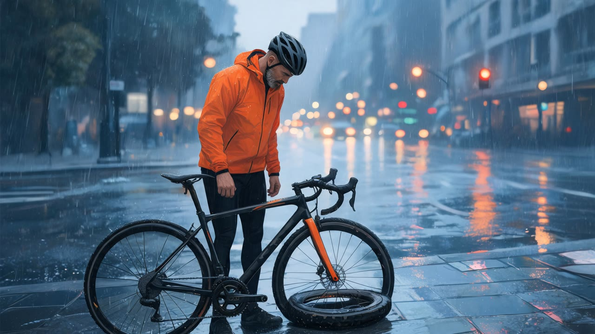
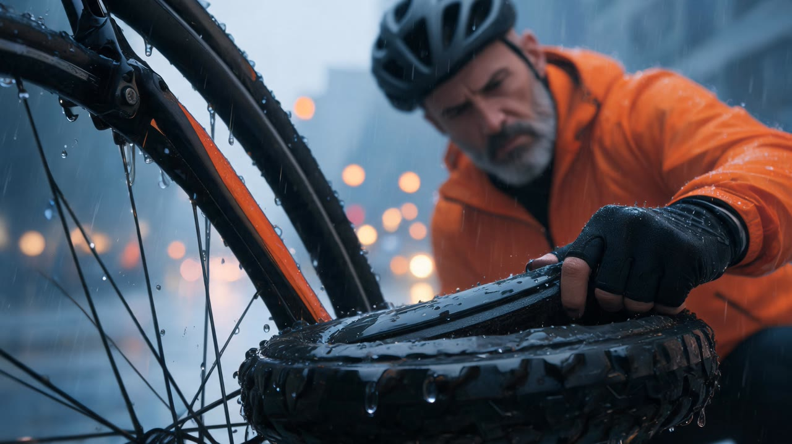
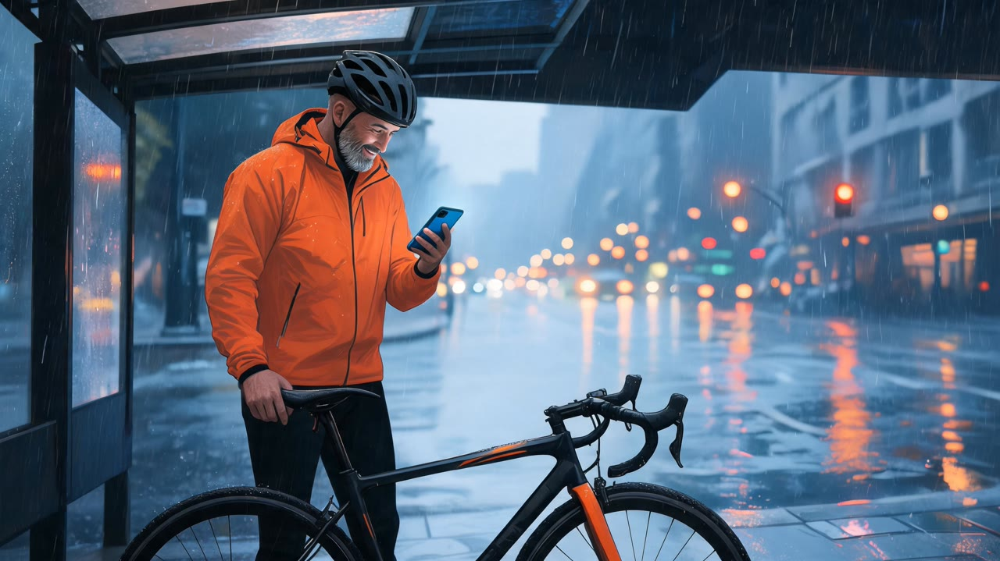
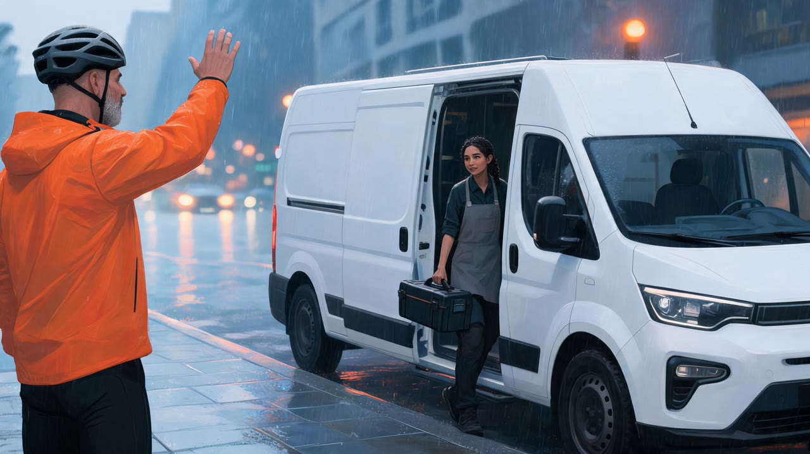
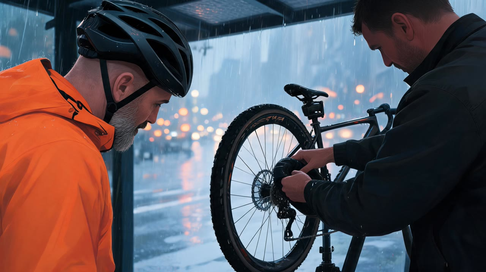
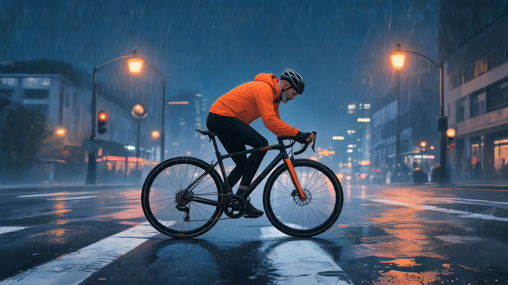

# Real run

One run of this skill's Wireflow app (`skill-ai-storyboard-generator`, six Seedream 5 Lite nodes at the landscape 16:9 preset) on 21 October 2026, for a made-up 30 second ad about a mobile bike repair service. Panel 1 is drawn from text alone; panels 2 to 6 use panel 1 as the reference for the hero and the style. The files here are downscaled to 1280 px wide; the originals are on the Wireflow CDN.

## Inputs

- `style`: Cinematic colour storyboard frames, soft digital painting with visible brush texture, muted city palette of slate blue and wet asphalt grey with warm orange highlights from street lights and the bike, gentle film grain, wide-angle cinematic framing.
- `character`: A man in his late 40s with a short salt-and-pepper beard, light brown skin and a shaved head, lean build, wearing a bright orange cycling rain jacket, black cycling tights and a matte black helmet.
- `panel_1`: Wide establishing shot, high angle: a rainy city street at dusk, the man stands beside his road bike on the pavement, looking down at a completely flat rear tyre, traffic lights blurred behind him.
- `panel_2`: Close-up, low angle: his gloved thumb presses the flat rear tyre, rain drips off the rim, his frustrated face out of focus above it.
- `panel_3`: Medium shot under a bus shelter: he holds his phone in one hand and the bike by the saddle with the other, the screen lights his face blue, a small relieved smile.
- `panel_4`: Medium wide shot: a small white electric service van pulls up at the kerb, a young female mechanic with braided hair and a grey work apron steps out with a toolbox while he waves.
- `panel_5`: Close-up over the shoulder: the mechanic fits a new inner tube onto the rear wheel on a portable stand under the shelter, he watches and leans in, rain still falling behind them.
- `panel_6`: Wide tracking shot from the side: the man rides away along a wet bike lane at night, street lights reflecting in the puddles, his orange jacket glowing, confident and fast.

Execution: `d6d3a924-b13b-4538-a651-5acb2120b595`. Credits: 60 for the six frames (account balance 10,050 before, 9,990 after).

## Results

| Panel | Image | Original |
|---|---|---|
| 1, wide |  | https://cdn.wireflow.ai/d78325f0-ccfb-11f1-a9ce-0799675f916d.jpg |
| 2, close-up |  | https://cdn.wireflow.ai/f27a1260-ccfb-11f1-a9ce-0799675f916d.jpg |
| 3, medium |  | https://cdn.wireflow.ai/f9e52e40-ccfb-11f1-a9ce-0799675f916d.jpg |
| 4, medium wide |  | https://cdn.wireflow.ai/f28d9a60-ccfb-11f1-a9ce-0799675f916d.jpg |
| 5, over the shoulder |  | https://cdn.wireflow.ai/f9efb590-ccfb-11f1-a9ce-0799675f916d.jpg |
| 6, tracking |  | https://cdn.wireflow.ai/f289a2c0-ccfb-11f1-a9ce-0799675f916d.jpg |

Honest notes: the hero holds across all six frames (same grey beard, shaved head, orange jacket, black helmet and the same black and orange bike), the painted style and the blue and orange palette match, every frame is a different shot, and none has captions or panel numbers. What missed:

- Panel 5's mechanic is a man in a dark jacket, not the woman with braided hair from panel 4. Only the hero is locked by panel 1; the skill now tells Claude to describe every side character in full in each panel they appear in.
- Panel 1 shows a tyre lying loose on the pavement beside the bike instead of a flat tyre on the rear wheel, and panel 2 frames the front of the bike. For a planning board this reads fine; for a client deck it would be a rewrite of those two panels and a new run.
- Panel 6 rides across a crossing rather than along a marked bike lane.

Panel 1 came back at 3072x1728 and panels 2 to 6 at 3416x1920: all 16:9.

The run used the Wireflow Apps API (`POST /api/v1/apps/skill-ai-storyboard-generator/execute`), the same code path as the MCP `run_app` tool.
