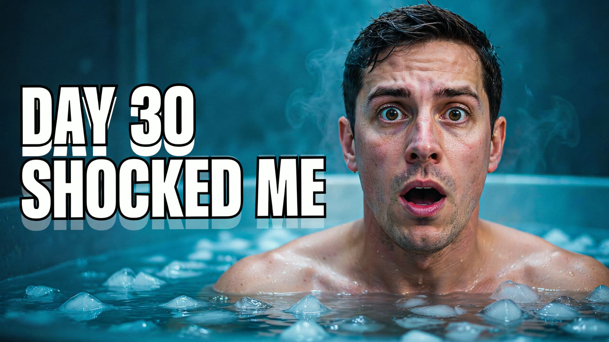
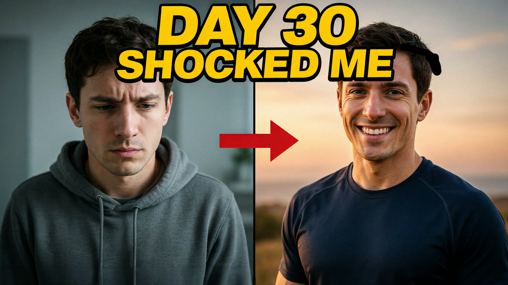
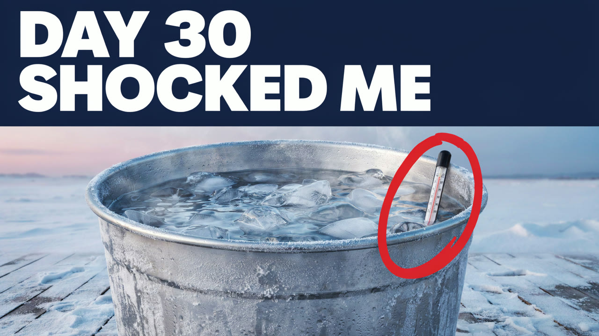

# AI Thumbnail Maker for Claude Code



| Before and after | Circle the detail |
|---|---|
|  |  |

*Three concepts for one video, one call. Made with this skill on 15 Oct 2026: Ideogram 4.5, 57 credits for all three. Inputs, receipt and honest notes in [examples](examples/EXAMPLES.md).*

Give Claude your video title and what happens in the video. This AI thumbnail maker writes a short headline that adds to the title, plans three different visual concepts and lets you edit every word. After your yes to the quoted credits, a Wireflow app renders all three as 16:9 YouTube thumbnails at 2560x1440, with the headline spelled exactly as approved. Claude then checks each image for spelling, legibility at phone size and stray marks, and saves them ready to upload or test.

No Wireflow connection? You still get the headline options and a concept sheet a designer can build.

## Try it

```text
Make 3 YouTube thumbnails for my video "I Tried Cold Plunging Every Day
for 30 Days". By day 30 I slept better and stopped hitting snooze.
Bold and high contrast, no face swaps.
```

Also triggered by: "YouTube thumbnail", "thumbnail ideas", "thumbnail variants to A/B test", "thumbnail text", "cover image for my video".

## How to install

```text
/plugin marketplace add wireflowINC/skills
/plugin install wireflow-skills@wireflow
```

The plugin brings the Wireflow skills and the connector; run `/mcp` → `wireflow` → sign in.

Only this skill: `npx skills add wireflowINC/skills --skill ai-thumbnail-maker`, or copy `skills/ai-thumbnail-maker` into `~/.claude/skills/`, then add the connector with `claude mcp add --transport http wireflow https://www.wireflow.ai/api/mcp` (Claude.ai and Desktop: custom connector, same URL).

## Works with

- **Claude Code**: where this skill is built to run. Install the plugin or use the skills CLI.
- **Claude.ai and Claude Desktop**: add Wireflow as a custom connector. Saving files needs a shell, so there you get the image links instead.
- **Cursor, Codex and other agents that read `SKILL.md`**: the skills CLI installs it there. Rendering needs that agent connected to the Wireflow MCP server; we have not tested those agents ourselves.

## Credits

| What | Credits |
|---|---|
| Headline options, concepts, quote | 0 |
| One run: 3 thumbnails, same headline | 57 (19 per image, Ideogram 4.5, measured 15 Oct 2026) |
| A second headline | 57 more, after a yes |

Wireflow's Free plan lets you build and browse and includes a first image after setup; rendering thumbnails needs a paid plan, from US$24 a month.

## What it will not do

- Promise something in the thumbnail the video does not show.
- Use other channels' logos or real people other than you.
- Put your own photo in the image: the app takes text only for now, so a designer composites a real face.
- Render vertical 9:16 Shorts covers: it is 16:9 only.

## Data

- The title, headline and concepts go to Wireflow through the Wireflow MCP connector (`run_app`), as you.
- Images download from `cdn.wireflow.ai` into `./wireflow-outputs/`.
- No keys, scripts or other services.

## FAQ

### How much does a thumbnail cost?

One run makes three thumbnails for 57 Wireflow credits, 19 per image with Ideogram 4.5 (measured 15 Oct 2026). Writing the headline and concepts is free. Claude quotes the cost and waits for your yes before anything renders.

### Do I need a Wireflow account?

Yes, for rendering: a Wireflow account with credits, connected through the Wireflow MCP connector. Without it you still get the headline options and the concept sheet.

### Which model makes the images, and will the text be spelled right?

Ideogram 4.5, chosen for clean lettering. You approve the exact words first and the app sends them without prompt rewriting. In our test the headline was spelled correctly in all three; Claude still reads every image letter by letter.

### What size are the thumbnails, and where do the files go?

2560x1440 PNG, 16:9, which YouTube accepts as a video thumbnail. They are saved to `./wireflow-outputs/<date>/thumbnails/`, with the CDN links in the report. Export as JPG if a file is over YouTube's 2 MB limit.

## In this folder

- `SKILL.md`: the procedure.
- `reference/thumbnail-concepts.md`: headline rules, seven concept angles, layouts that read at small size, the concept sheet and a test plan.
- `examples/`: the real run, three thumbnails and the inputs.

Powered by [node based image generation](https://www.wireflow.ai/node-based-image-generation?ref=skill-ai-thumbnail-maker&utm_source=github&utm_medium=skill&utm_campaign=ai-thumbnail-maker) on [Wireflow, the node-based AI workflow platform](https://www.wireflow.ai/features/best-node-based-ai-workflow-platform?ref=skill-ai-thumbnail-maker&utm_source=github&utm_medium=skill&utm_campaign=ai-thumbnail-maker). MIT licensed; renders use your Wireflow credits.
