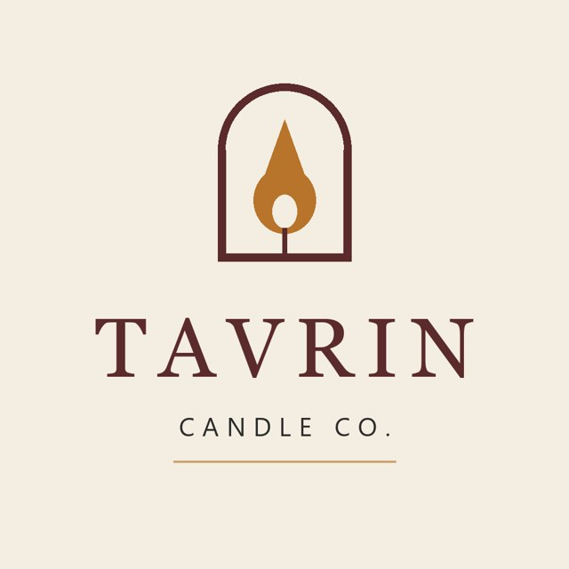
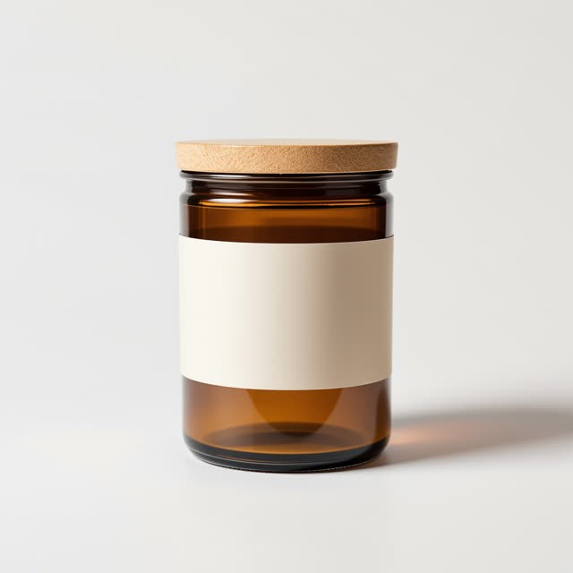
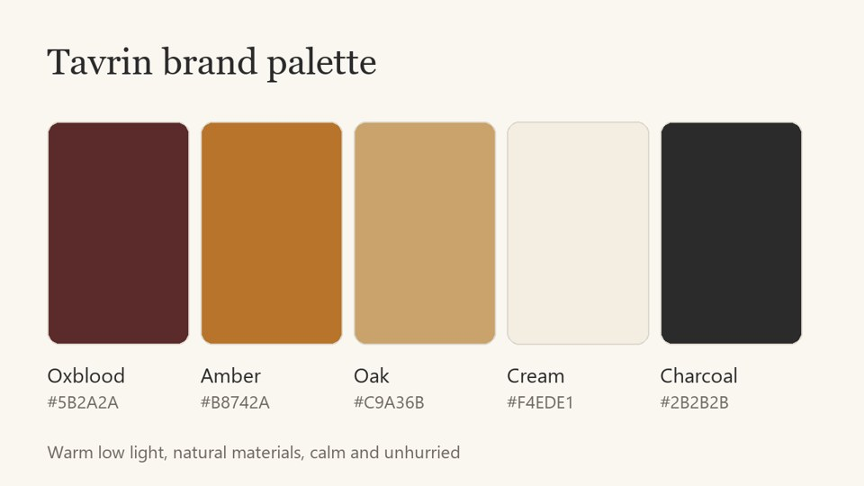
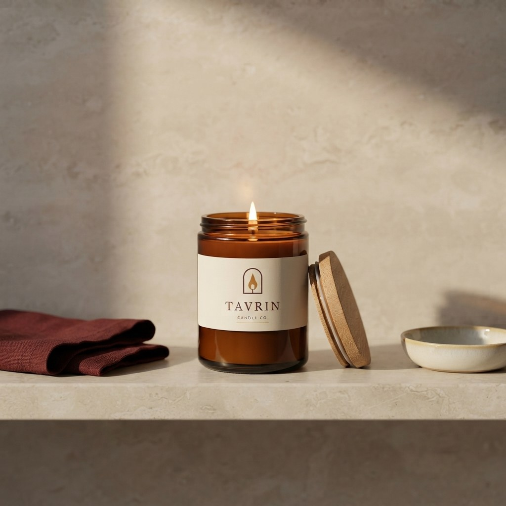
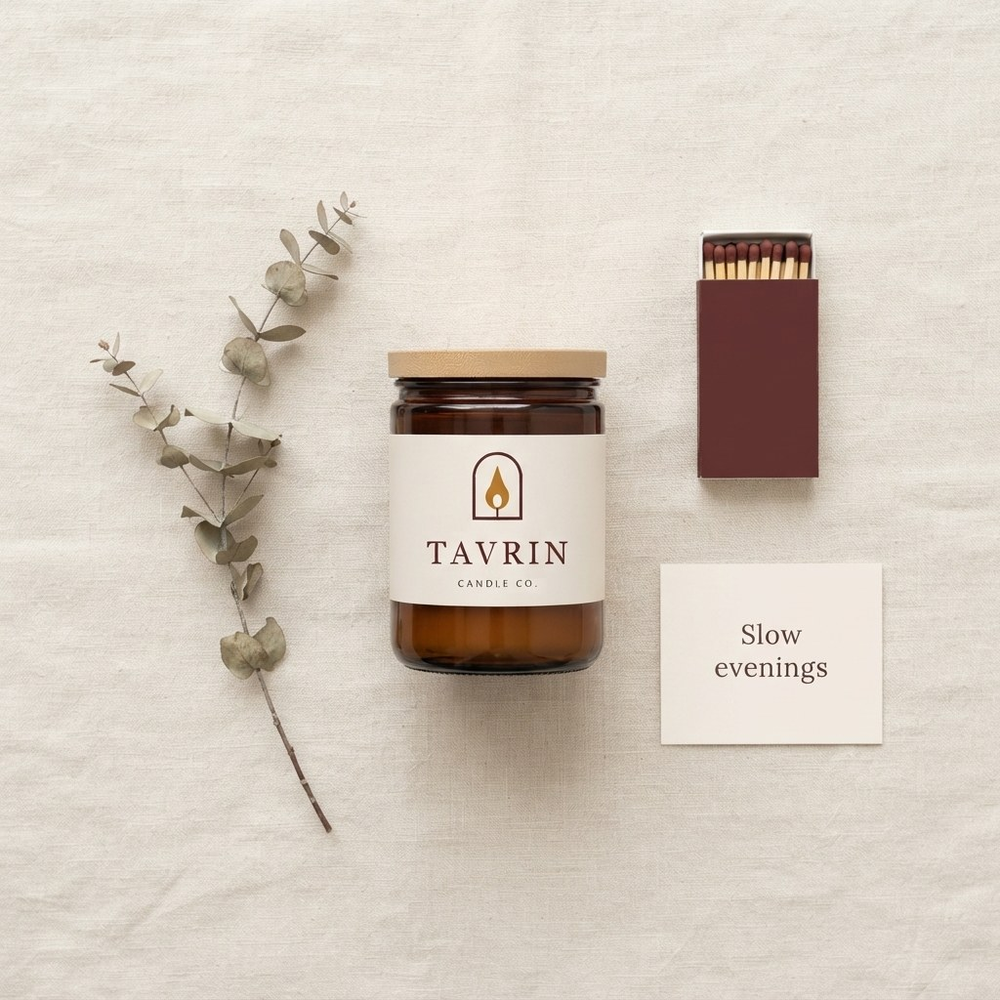

# Real runs

Made by this skill's Wireflow app (`skill-brand-consistent-images`, Nano Banana Lite) on 15 October 2026. Files here are downscaled copies; the originals are on the Wireflow CDN.

## The brand kit

Tavrin Candle Co. is an invented brand, made up for this example so the repo holds no real company's logo.

`brand_image_1`, the logo, drawn for this example: https://cdn.wireflow.ai/uploads/api/3/a1c4180a-14c7-4d2c-a8a2-9b23c9643b9f.png

`brand_image_2`, the product: an amber candle jar with a blank label, generated earlier with the ai-image-generation skill: https://cdn.wireflow.ai/bae51ed0-c2ab-11f1-81b3-8fc0dc6bd2a6.jpg

`brand_image_3`, the palette card, drawn for this example: https://cdn.wireflow.ai/uploads/api/3/d73e5e25-ae0b-4a1d-a9ef-8fe30e2e2ccf.png

## Run 1: bathroom shelf post (all three brand images)

- `brand_brief`: Tavrin Candle Co., hand-poured candles. Palette: oxblood #5B2A2A, amber #B8742A, oak #C9A36B, cream #F4EDE1, charcoal #2B2B2B. Light: warm, low evening light with soft shadows. Surfaces: natural stone, oak, linen, ceramic. People: none. Mood: calm, unhurried, uncluttered. Avoid: neon, glossy plastic, busy backgrounds, extra text.
- `image_request`: Instagram post: the amber candle jar from the product photo standing on a pale stone bathroom shelf beside a folded oxblood linen towel and a small ceramic dish, the Tavrin logo printed on the jar's cream label, the oak lid resting against the jar and the candle lit with a small warm flame, warm low evening light, calm negative space
- Output: 1024x1024 JPEG, https://cdn.wireflow.ai/gemini-f010eda6-fd25-4a94-98ae-59581dc1f234.jpg
- Execution: `970c7cd7-630d-40b3-b878-092141e9bfd3`
- Credits: 16 (balance 5,344 before, 5,328 after)
- Honest notes: the arch and flame mark and the TAVRIN wordmark came through cleanly on the blank label, and the lid is off for the lit candle. The small "CANDLE CO." line under the wordmark is soft, and the jar's shoulder is a little narrower than in the product photo.

## Run 2: flat lay with a quoted line (logo and product only)

- `brand_brief`: Tavrin Candle Co., hand-poured candles. Palette: oxblood #5B2A2A, amber #B8742A, oak #C9A36B, cream #F4EDE1, charcoal #2B2B2B. Light: soft daylight, gentle shadows. Surfaces: linen, oak, ceramic, dried botanicals. People: none. Mood: calm, unhurried, uncluttered. Avoid: neon, glossy plastic, busy backgrounds.
- `image_request`: Flat lay seen from directly above on cream linen: the amber candle jar from the product photo with its oak lid on and the Tavrin logo on its cream label, a sprig of dried eucalyptus, an oxblood matchbox, and a small cream gift card that reads "Slow evenings" in a simple serif. Soft daylight, neat balanced layout with negative space, no other text.
- `brand_image_3` left out on purpose, to check that an empty slot runs cleanly. It did.
- Output: 1024x1024 JPEG, https://cdn.wireflow.ai/gemini-3e900eb2-189f-4ca7-9177-7a6296b5d62d.jpg
- Execution: `3939280d-3767-4ca6-9dc2-930a5d240637`
- Credits: 16 (balance 5,328 before, 5,312 after)
- Honest notes: "Slow evenings" is spelled exactly, the matchbox picked up the oxblood from the brief, and the logo matches the reference. The props are shot from above, but the jar is shown from the front, so the view is not a true flat lay.

## How these were run

Through the Wireflow Apps API (`POST /api/v1/apps/skill-brand-consistent-images/execute`), the same code path as the MCP `run_app` tool, under a 50-credit cap for the test. Total spent: 32 credits, matching the list price of 16 per image. A fresh Claude session run through the MCP connector is still to be recorded.
