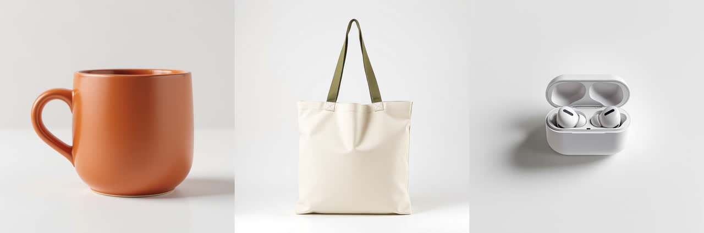
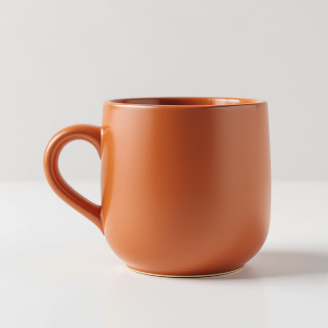
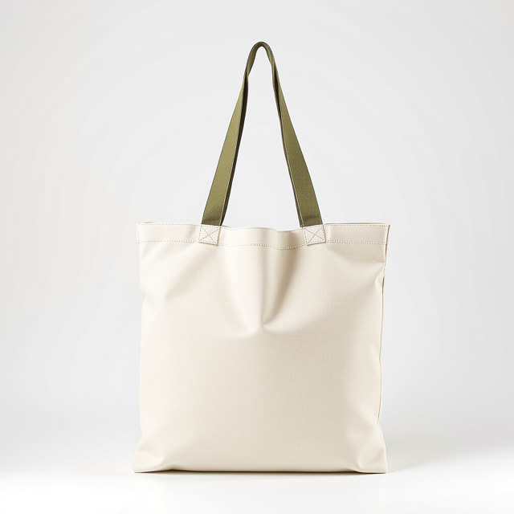
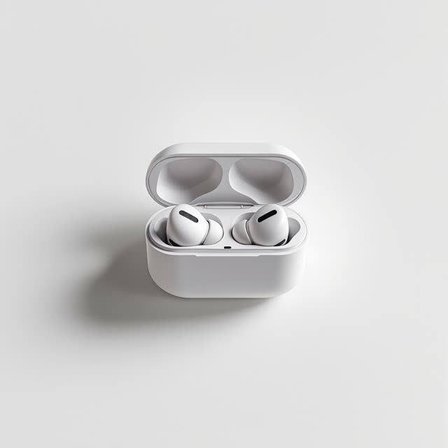

# Real batch

A 3-row pilot batch run through this skill's Wireflow app (`skill-bulk-image-generation`, Flux Pro Ultra, 1:1) on 8 October 2026. Files here are downscaled; originals are on the Wireflow CDN.



## Input CSV

```csv
filename,aspect_ratio,prompt
mug-terracotta,1:1,"E-commerce studio packshot of a matte terracotta ceramic coffee mug with a thick rounded handle, three-quarter view, centered on a seamless pure white background, soft even studio light, gentle contact shadow, sharp focus, no text, no logo, full bleed, no border, no frame"
tote-cream,1:1,"E-commerce studio packshot of a natural cream canvas tote bag with olive green cotton straps, standing upright and slightly open, front view, centered on a seamless pure white background, soft even studio light, gentle contact shadow, sharp focus, no text, no logo, full bleed, no border, no frame"
earbuds-white,1:1,"E-commerce studio packshot of a pair of matte white wireless earbuds sitting in an open rounded charging case, three-quarter top view, centered on a seamless pure white background, soft even studio light, gentle contact shadow, sharp focus, no text, no logo, full bleed, no border, no frame"
```

## Manifest written by the batch

```csv
row,filename,aspect_ratio,status,execution_id,credits,url
1,mug-terracotta,1:1,done,9fbb1c0b-0a22-48da-93fa-48dca7a16121,19,https://cdn.wireflow.ai/a7492500-c2d4-11f1-9e92-2dd4e060cd9a.jpg
2,tote-cream,1:1,done,9c43f307-e8ef-42d3-a7c9-21bde693f6cd,19,https://cdn.wireflow.ai/b1f03200-c2d4-11f1-9e92-2dd4e060cd9a.jpg
3,earbuds-white,1:1,done,884a13ee-b370-41ae-a87e-b7b9ef820dce,19,https://cdn.wireflow.ai/bbdc5370-c2d4-11f1-9e92-2dd4e060cd9a.jpg
```

## Rows

| Row | File | Execution | Credits | Original |
|---|---|---|---|---|
| 1 |  | `9fbb1c0b-0a22-48da-93fa-48dca7a16121` | 19 | https://cdn.wireflow.ai/a7492500-c2d4-11f1-9e92-2dd4e060cd9a.jpg |
| 2 |  | `9c43f307-e8ef-42d3-a7c9-21bde693f6cd` | 19 | https://cdn.wireflow.ai/b1f03200-c2d4-11f1-9e92-2dd4e060cd9a.jpg |
| 3 |  | `884a13ee-b370-41ae-a87e-b7b9ef820dce` | 19 | https://cdn.wireflow.ai/bbdc5370-c2d4-11f1-9e92-2dd4e060cd9a.jpg |

Batch total: 57 credits (3 x 19, each measured as account balance before minus after).

Honest notes: the mug came out cropped at the left edge although the prompt asked for it centered, and all three share the white-seamless style line as intended. These generated packshots were later used as input photos for the ai-ad-creative-generator and ugc-ad-generator skill tests.

These runs used the Wireflow Apps API (`POST /api/v1/apps/skill-bulk-image-generation/execute`), the same code path as the MCP `run_app` tool the skill calls.
