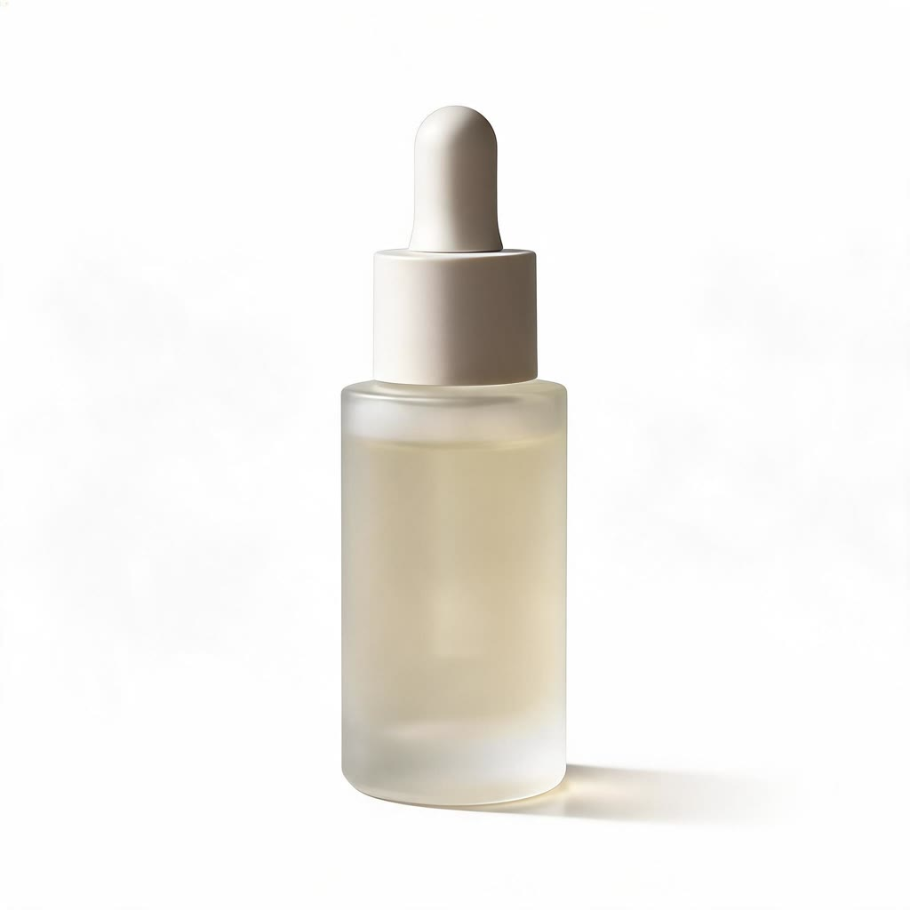
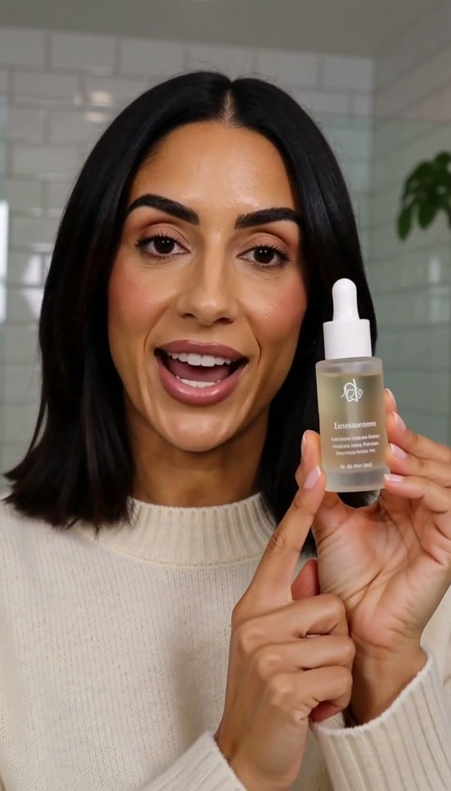
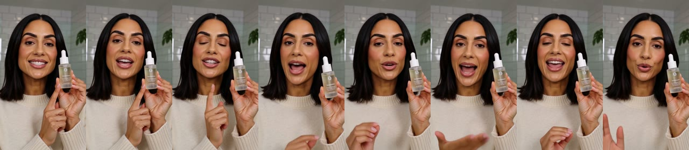

# Real runs

Made by this skill's Wireflow app (`skill-heygen-video-product-video`, HeyGen Video, 8 seconds, 9:16, 768p, prompt enhancement off) on 16 October 2026. The MP4s stay on the Wireflow CDN; this folder keeps the product photo, a poster frame and a frame strip of the second run, all 1280px or less.

## Product photo

A plain, unlabelled serum bottle on white, made earlier by the amazon-product-images skill test: https://cdn.wireflow.ai/e7ce0550-c2d4-11f1-9e92-2dd4e060cd9a.jpg

## Serum routine presenter clip

- `product_photo`: https://cdn.wireflow.ai/e7ce0550-c2d4-11f1-9e92-2dd4e060cd9a.jpg
- `presenter`: A friendly woman in her early 30s with shoulder-length dark hair, natural makeup and a cream knit sweater, standing in a bright bathroom with white tiles and a plant, relaxed and warm.
- `script`: This is the serum I use every night. Three drops, pat it in, and that is my whole routine.
- Output: 768x1344 MP4, 8.0 s, 24 fps, stereo AAC voice track, https://cdn.wireflow.ai/e4aa6130-c8f5-11f1-bb62-0520a10573d1.mp4
- Execution: `be6c2000-a959-4541-8c97-bd87c20c2ddc`
- Credits: 72 (Wireflow credit history, `Heygen Video 1`; the account balance was flat for a minute before the run and fell exactly 72)
- Ready in about 20 seconds.
- Honest notes: the presenter matches the brief, stays the same person in every frame, talks to the camera and holds the bottle beside her face the whole time; bottle shape, white dropper cap and pale liquid match the photo. But the photo's bottle is plain and HeyGen printed a label with a small logo and unreadable text on it. The app's fixed rules already said not to add any label or text. The voice track is loud and clear (mean volume -16.8 dB); we did not check by ear that every word of the script was spoken.

## First run (before the no-label rule)

- Execution `28b6ddc2-205d-4244-bfa4-e0921675b1a2`, same inputs, 72 credits, ready in about 20 seconds: https://cdn.wireflow.ai/758be080-c8f5-11f1-bb62-0520a10573d1.mp4
- It also printed a made-up label on the plain bottle. We then added "do not add any label, sticker, logo, text or pattern that is not on the product" to the app's fixed rules and ran the second take above; the label came back anyway, so the skill now warns about it up front.

## How these were run

The Wireflow Apps API (`POST /api/v1/apps/skill-heygen-video-product-video/execute`), the same code path as the MCP `run_app` tool. The execution id of the serum routine clip matches `testReceipt.executionId` in the queue item.
